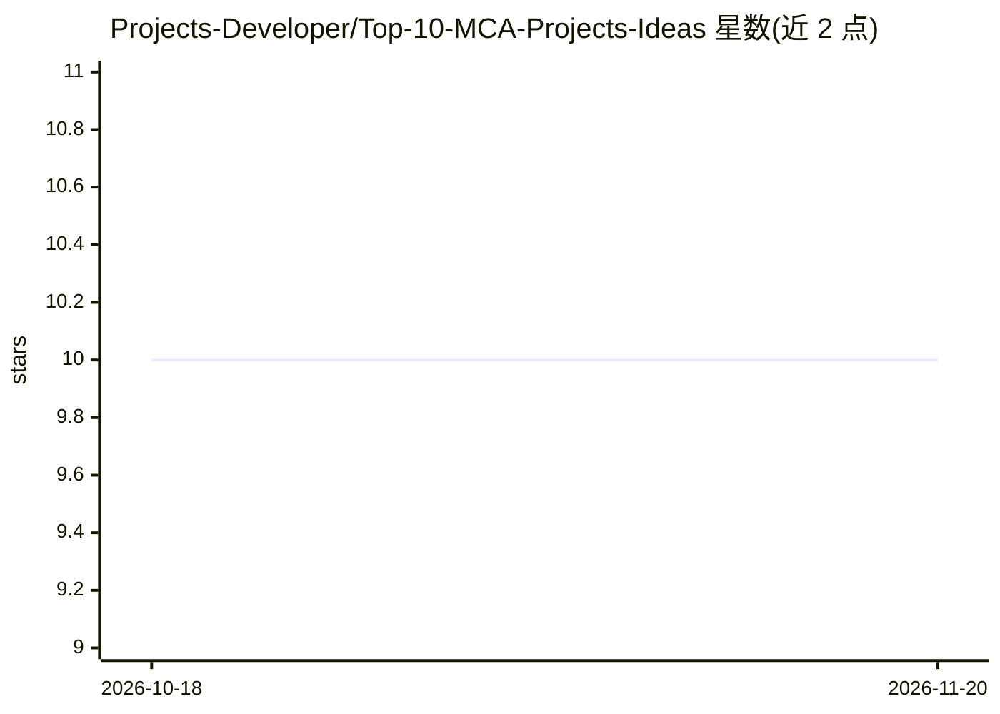

# Projects-Developer/Top-10-MCA-Projects-Ideas

⭐ 10 · 推送 2026-01-22 · [GitHub](https://github.com/Projects-Developer/Top-10-MCA-Projects-Ideas) · [官网](https://www.finalproject.in/) · 个人维护

**面向 MCA 毕业生的项目选题清单，附教程与材料获取方式**

面向 MCA/BCA/B.Tech 毕业年学生的项目选题汇总清单，列出 12 个项目方向（推荐系统、NLP 聊天机器人、股价预测、人脸识别考勤、区块链投票等），每个条目附 YouTube 讲解视频链接。README 未直接提供代码，材料（Synopsis、PPT、报告、代码、研究论文、讲解视频）需通过邮件、WhatsApp 或网站联系获取。

## 筛选速览

| 维度 | 判定 | 备注 |
|---|---|---|
| AI 角色 | `ai-knowledge` | 知识聚合/清单类 |
| 许可风险 | `none` | — |
| 部署形态 | `None` |  |
| 模型依赖 | — | README 未给出锁定关系 |
| 硬件要求 | — | 无带数字的原话,不猜 |
| 安装摩擦 | `low` | 无编译、无系统依赖或容器化 |
| 成熟度 | — | 结构信号不足 |

## 能力要点

- 列出 12 个毕业项目选题及对应 YouTube 视频链接
- 选题覆盖机器学习、NLP、区块链、密码学、物联网等方向
- 提供联系渠道获取项目配套材料

## 适用场景

- 为毕业设计寻找选题方向
- 查看机器学习/区块链等项目的讲解视频
- 联系作者获取项目代码与文档

## 场景标签

`教程课程` `精选清单` · 领域:学习与行业

## 证据(README 行号)

> L1: # Top 10 MCA Projects Ideas
> L2:  Top 10 MCA Projects For Final Year With Code, Documents, And Video Tutorial
> L8: ## Top 10 MCA Projects Link

## 星数曲线

2026-10-18 10 → 2026-11-20 10（+0）

---
*卡片 v1 · prompt 1.4 · 生成 2026-11-20 · 置信度 high · 依据 README sha `447432edc535` · [字段定义](../../DATASET.md)*
