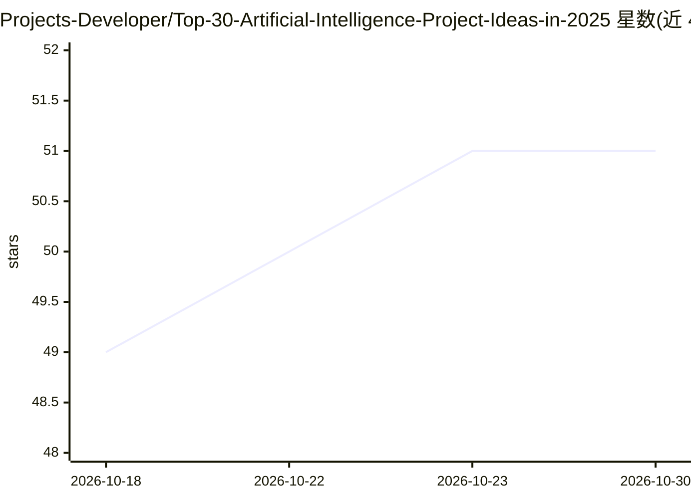

# Projects-Developer/Top-30-Artificial-Intelligence-Project-Ideas-in-2025

⭐ 51 · 推送 2026-01-22 · [GitHub](https://github.com/Projects-Developer/Top-30-Artificial-Intelligence-Project-Ideas-in-2025) · [官网](https://www.finalproject.in) · 个人维护

**面向学生的 30 个 AI 毕业设计项目选题清单（附视频教程）**

列出约 29 个 AI/机器学习项目选题，涵盖 UPI 欺诈检测、假新闻检测、疾病预测、恶意软件检测、股价预测、植物病害检测、人脸检测等，每项附 YouTube 视频教程链接。声明每个项目包含大纲（Synopsis）、PPT、研究论文、源代码、讲解视频、文档与报告，但仓库内未直接提供这些材料，而是通过邮件、WhatsApp 或网站 finalproject.in 联系作者获取。面向 BCA/BTech/MCA/MTech 等毕业设计需求的学生。

## 筛选速览

| 维度 | 判定 | 备注 |
|---|---|---|
| AI 角色 | `ai-knowledge` | 知识聚合/清单类 |
| 许可风险 | `none` | — |
| 部署形态 | `None` |  |
| 模型依赖 | — | README 未给出锁定关系 |
| 硬件要求 | — | 无带数字的原话,不猜 |
| 安装摩擦 | `low` | 无编译、无系统依赖或容器化 |
| 成熟度 | — | 结构信号不足 |

## 能力要点

- 约 29 个 AI/ML 项目选题，每项附视频教程链接
- 声明配套 Synopsis/PPT/研究论文/代码/文档/报告
- 通过邮件、WhatsApp 与网站联系获取项目材料

## 适用场景

- 毕业设计选题时浏览 AI 项目方向与参考
- 查看各选题的讲解视频了解实现思路
- 通过作者联系方式获取完整项目材料

## 场景标签

`教程课程` · 领域:学习与行业

## 证据(README 行号)

> L1: # Top 30 Artificial Intelligence Project Ideas in 2025
> L2: Top 30 Artificial Intelligence Project Ideas in 2025 Includes Source Code, PPT, Synopsis, Report, Documents, Base Re
> L24: ### Project include:

## 星数曲线

2026-10-18 49 → 2026-10-30 51（+2）

---
*卡片 v1 · prompt 1.4 · 生成 2026-10-24 · 置信度 high · 依据 README sha `53742ba63b93` · [字段定义](../../DATASET.md)*
