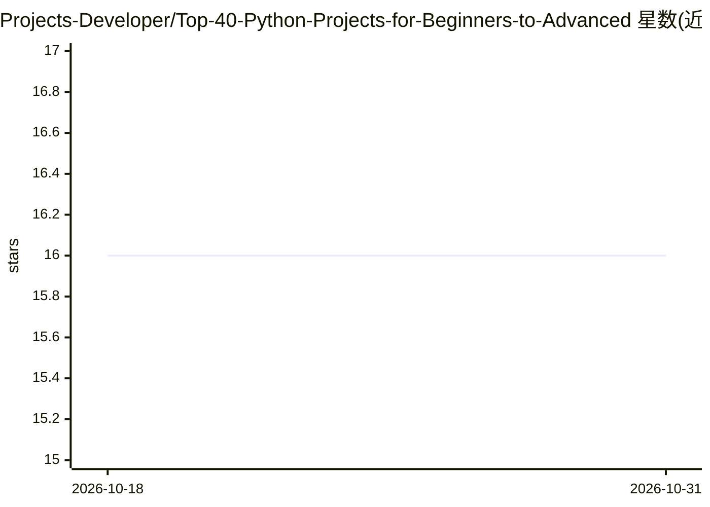

# Projects-Developer/Top-40-Python-Projects-for-Beginners-to-Advanced

⭐ 16 · 推送 2026-01-22 · [GitHub](https://github.com/Projects-Developer/Top-40-Python-Projects-for-Beginners-to-Advanced) · [官网](https://www.finalproject.in/) · 个人维护

**40 个 Python 毕业设计项目清单：含代码、文档与视频教程链接**

面向 BCA/BTech/MCA/MTech 学生与毕业设计需求者的 Python 项目清单：列出 40 个项目名称及对应 YouTube 视频教程链接，主题涵盖机器学习（疾病预测、垃圾检测、股市预测）、区块链（土地登记、健康记录）与深度学习（恶意软件检测、人脸识别）。声称每个项目附带简介、PPT、研究论文、代码、说明视频、文档与报告，获取方式为通过邮件/WhatsApp/网站联系维护者。README 未展示项目源码本体。

## 筛选速览

| 维度 | 判定 | 备注 |
|---|---|---|
| AI 角色 | `ai-knowledge` | 知识聚合/清单类 |
| 许可风险 | `none` | — |
| 部署形态 | `None` |  |
| 模型依赖 | — | README 未给出锁定关系 |
| 硬件要求 | — | 无带数字的原话,不猜 |
| 安装摩擦 | `low` | 无编译、无系统依赖或容器化 |
| 成熟度 | — | 结构信号不足 |

## 能力要点

- 40 个项目条目，各带视频教程链接
- 覆盖机器学习、深度学习、区块链等主题
- 声称配套 Synopsis、PPT、研究论文、代码与报告等材料
- 通过邮件/WhatsApp/网站联系方式获取项目材料

## 适用场景

- 毕业设计选题参考与教程查找
- 学习机器学习/区块链项目的实现方式
- 按视频教程跟随完成课程项目

## 场景标签

`精选清单` · 领域:学习与行业

## 证据(README 行号)

> L8: ## Top 40 Python Projects for Beginners to Advanced
> L51: ### Project include:

## 星数曲线

2026-10-18 16 → 2026-10-31 16（+0）

---
*卡片 v1 · prompt 1.4 · 生成 2026-10-30 · 置信度 high · 依据 README sha `4fbe2e5ffd04` · [字段定义](../../DATASET.md)*
