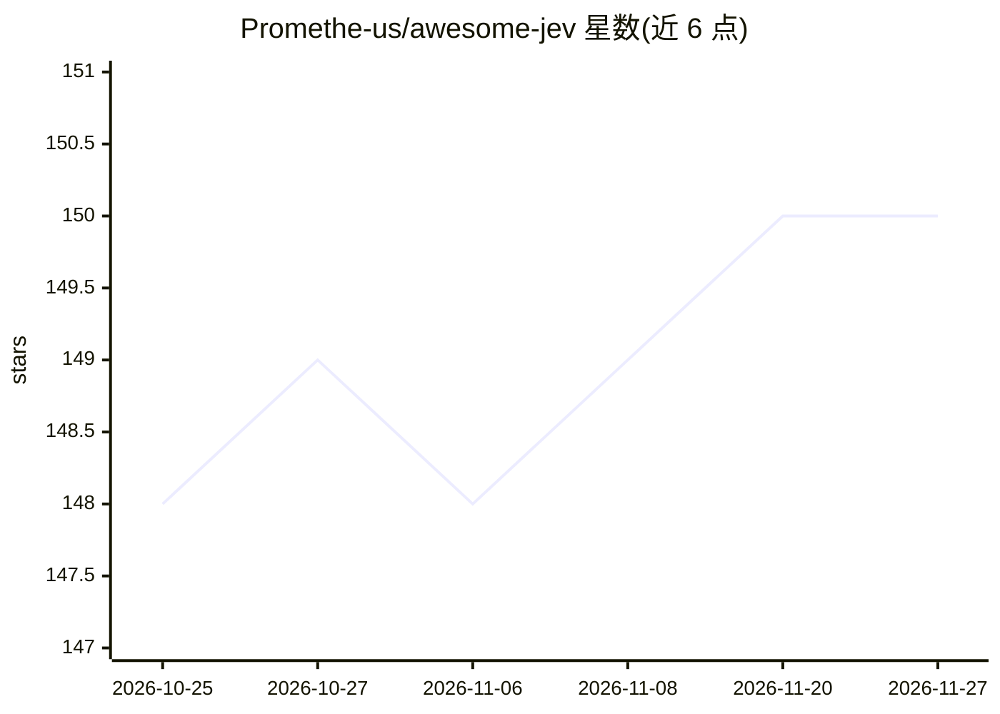

# Promethe-us/awesome-jev

⭐ 150 · MIT · 推送 2026-11-09 · [GitHub](https://github.com/Promethe-us/awesome-jev) · [官网](https://promethe-us.github.io/awesome-jev/) · 个人维护 · 中文 README

**面向研究者和开发者的 Jev/System One 资源知识地图**

一个来源可核验的 Jev / System One 知识地图，收录官方资料、社区项目、论文、评测、机器人实践与社交平台线索，并标注每条目的核验状态与作者报告边界。README 内含 Jev 模型规格速览、Agent Loop 决策层定位说明、多框架接入方式对照表、时间线与 GitHub 生态项目表；同时提供 GitHub Pages 网页导航站供浏览检索。仓库声明与 TypeSafe AI 官方无关，未复现任何性能主张。

## 筛选速览

| 维度 | 判定 | 备注 |
|---|---|---|
| AI 角色 | `ai-knowledge` | 知识聚合/清单类 |
| 许可风险 | `permissive` | MIT |
| 部署形态 | `None` |  |
| 模型依赖 | — | README 未给出锁定关系 |
| 硬件要求 | — | 无带数字的原话,不猜 |
| 安装摩擦 | `low` | 无编译、无系统依赖或容器化 |
| 成熟度 | — | 结构信号不足 |

## 能力要点

- 条目均附来源与核验状态（基线核验/增量复查日期）
- 汇总 Choice/Score/Noul 原语与多框架接入方式对照表
- X、小红书、知乎线索按已核验/待核验分开呈现
- 提供 GitHub Pages 网页导航站与完整目录链接

## 适用场景

- 查找 Jev / System One 相关论文、评测与社区项目
- 对比各框架接入 Jev 的方式与注意事项
- 跟踪 Jev 生态的发布动态与社区实践线索

## 场景标签

`精选清单` · 领域:学习与行业

## 证据(README 行号)

> L11: **精选 Jev / System One 官方资料、社区实践与研究阅读**
> L12: **A source-backed collection of Jev resources, community projects, and research.**
> L24: > 社区整理，与 TypeSafe AI 官方无关。**全库基线核验：2026-09-24；增量复查至 2026-09-28（Asia/Shanghai）**。来源可读取不等于性能已被本仓库复现；覆盖范围与访问限制见 核验记录。

## 星数曲线

2026-10-25 148 → 2026-11-27 150（+2）

---
*卡片 v1 · prompt 1.4 · 生成 2026-11-27 · 置信度 high · 依据 README sha `69db51795be5` · [字段定义](../../DATASET.md)*
