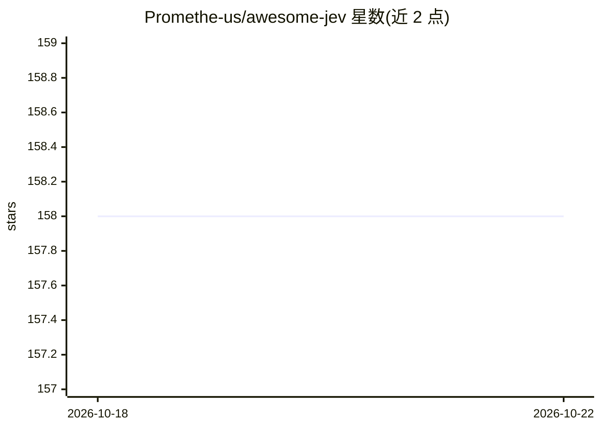

# Promethe-us/awesome-jev

⭐ 158 · MIT · 推送 2026-10-19 · [GitHub](https://github.com/Promethe-us/awesome-jev) · [官网](https://promethe-us.github.io/awesome-jev/) · 个人维护 · 中文 README

**Jev/System One 决策模型的资源清单：项目、论文、评测与社区线索**

社区维护的 Jev（TypeSafe AI 的 System One 决策模型）知识地图：汇总官方资源与接入方式速查、GitHub 生态项目（浏览器、上下文管理、开放模型、训练实现）、X/小红书/知乎实践线索与 arXiv 论文，并附来源核验记录与基线核验日期。README 同时解释 Jev 的三种原语（Choice/Score/Noul）、速率与价格等规格，以及'决策层而非生成层'的定位。与 TypeSafe AI 官方无关，所有性能数字均为作者报告，未在本仓库复现。

## 筛选速览

| 维度 | 判定 | 备注 |
|---|---|---|
| AI 角色 | `ai-knowledge` | 知识聚合/清单类 |
| 许可风险 | `permissive` | MIT |
| 部署形态 | `None` |  |
| 模型依赖 | — | README 未给出锁定关系 |
| 硬件要求 | — | 无带数字的原话,不猜 |
| 安装摩擦 | `low` | 无编译、无系统依赖或容器化 |
| 成熟度 | — | 结构信号不足 |

## 能力要点

- 覆盖官方 SDK、Vercel/Cloudflare/OpenRouter/LangChain 等多渠道接入方式速查表
- GitHub 生态分类目录：浏览器、上下文管理、开放模型、训练配方与 Agent 评测
- X/小红书/知乎多平台线索均带核验状态标注（已核验/待核验/未能复核）
- 全库基线核验与增量复查日期及来源审计记录

## 适用场景

- 查找 Jev 模型的接入方式与各渠道接口差异
- 追踪 Jev 相关的开源项目、论文与评测
- 了解社区在机器人、浏览器自动化等方向的实践线索

## 场景标签

`精选清单` · 领域:学习与行业

## 证据(README 行号)

> L11: **精选 Jev / System One 官方资料、社区实践与研究阅读**
> L53: Jev 是 TypeSafe AI 的决策模型。程序提供文本状态和边界明确的问题，模型返回 **Choice / Score / Noul**；应用代码解释结果并决定下一步。TypeSafe 将这类模型称为 **System On

## 星数曲线

2026-10-18 158 → 2026-10-22 158（+0）

---
*卡片 v1 · prompt 1.4 · 生成 2026-10-22 · 置信度 high · 依据 README sha `b57048789416` · [字段定义](../../DATASET.md)*
