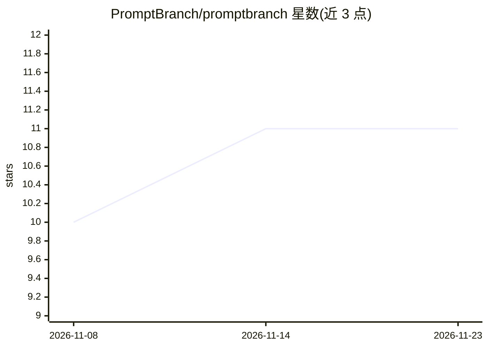

# PromptBranch/promptbranch

⭐ 11 · TypeScript · MIT · 推送 2026-10-16 · [GitHub](https://github.com/PromptBranch/promptbranch) · [官网](https://promptbranch.app) · 个人维护

**本地优先的 AI 提示词库与版本控制工具**

PromptBranch 是本地优先的提示词管理工具，覆盖创建、组织、版本跟踪与测试运行。核心机制：类 Git 的分支/版本/diff 管理；通过 models.dev 目录对接 OpenAI、Anthropic、Google 及 OpenAI 兼容端点，单次最多并发运行 6 个模型并记录 token 用量与成本；提供桌面应用、CLI 与 MCP server 三种入口共享同一本地数据库。Agent 的修改建议需人工批准后才生效，数据存储与多设备同步均不经过服务器。当前标注为开发中状态。

## 筛选速览

| 维度 | 判定 | 备注 |
|---|---|---|
| AI 角色 | `ai-native` | 本体是模型或模型工具 |
| 许可风险 | `permissive` | MIT |
| 部署形态 | `library` | 以包/库形式分发 |
| 模型依赖 | local-ok | 支持本地模型 |
| 硬件要求 | — | 无带数字的原话,不猜 |
| 安装摩擦 | `low` | 无编译、无系统依赖或容器化 |
| 成熟度 | `idea` | |

## 能力要点

- 提示词版本控制：分支、稳定版本 ID、diff 与变更备注
- 最多 6 模型并发运行，含 token/成本跟踪与 LLM judge 评估
- 桌面应用、CLI、MCP server 三入口共享同一 SQLite 数据库
- 本地网络 P2P 同步，无需服务器与账户，配对码认证

## 适用场景

- 集中管理并版本化我的 AI 提示词
- 同一提示词对比多个模型的输出效果
- 让编码 agent 读写提示词库而由我人工审批改动
- 在多台电脑间离线同步提示词库

## 场景标签

`提示工程` · 领域:Agent 开发

## 证据(README 行号)

> L5: **A local-first prompt library and version-control system for AI prompts.**
> L138: PromptBranch can run prompts against real models and use AI to draft or improve

## 星数曲线

2026-11-08 10 → 2026-11-23 11（+1）

---
*卡片 v1 · prompt 1.4 · 生成 2026-11-18 · 置信度 high · 依据 README sha `d16dd8c8f588` · [字段定义](../../DATASET.md)*
