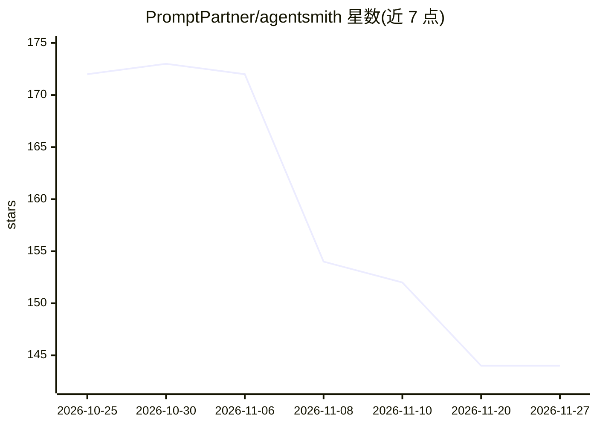

# PromptPartner/agentsmith

⭐ 144 · Python · MIT · 推送 2026-11-26 · [GitHub](https://github.com/PromptPartner/agentsmith) · [官网](https://agentsmith.diy) · 组织维护 · 中文 README

**给编码 agent 的通用运行框架：任务界定+验证证据+交接**

围绕 Claude Code、Codex 等编码 agent 的开源运行框架，通过向导式安装脚本将项目规则、完成定义与验证检查写入仓库，生成 AGENTS.md、verify.conf 与状态文件，记录失败测试、验证输出、回执与可续接的交接信息，并提供九类按工作类型的配置档案（软件开发、DevOps、文档、数据、安全审计等）。支持 macOS/Windows/Linux 独立构建包、由 agent 读取安装指南自动安装、以及源码构建三种途径。

## 筛选速览

| 维度 | 判定 | 备注 |
|---|---|---|
| AI 角色 | `ai-ecosystem` | LLM/agent 周边工具 |
| 许可风险 | `permissive` | MIT |
| 部署形态 | `None` |  |
| 模型依赖 | — | README 未给出锁定关系 |
| 硬件要求 | — | 无带数字的原话,不猜 |
| 安装摩擦 | `low` | 无编译、无系统依赖或容器化 |
| 成熟度 | — | 结构信号不足 |

## 能力要点

- 九类工作档案与 autonomous-loops 高级修饰符
- 独立构建包含自带运行时，无需 Python
- 自动生成 AGENTS.md 并为 Claude Code 生成 CLAUDE.md
- 本地记忆检索 agentsmith memory 与配置审计 agentsmith audit-config

## 适用场景

- 让编码 agent 在修改代码前先定义完成检查并保留验证证据
- 为现有项目添加可随仓库协作评审的 agent 规则与验证脚手架
- 为不同工作类型（文档、数据、营销、安全审计）配置对应的验收标准
- 以 maker/checker 方式进行限定范围的受控 agent 运行

## 场景标签

`编码 Agent` `Agent 框架` · 领域:Agent 开发

## 证据(README 行号)

> L9: # AgentSmith — the open-source harness for coding agents
> L26: AgentSmith: project rules and configured checks around Claude Code or Codex; understand and bound the task, verify 
> L36: ## Set up AgentSmith

## 星数曲线

2026-10-25 172 → 2026-11-27 144（-28）

---
*卡片 v1 · prompt 1.4 · 生成 2026-11-27 · 置信度 high · 依据 README sha `43d6ad4e4aab` · [字段定义](../../DATASET.md)*
