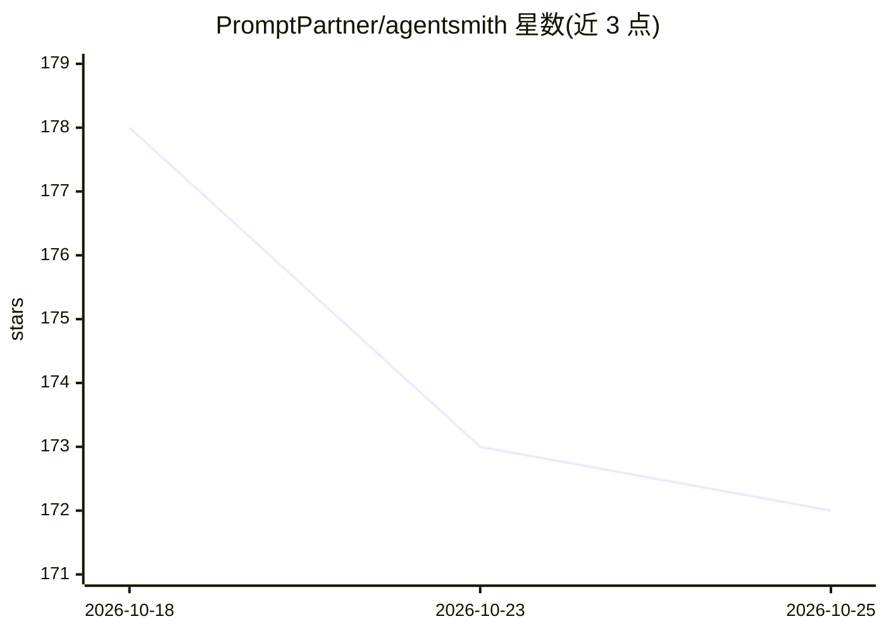

# PromptPartner/agentsmith

⭐ 172 · Python · MIT · 推送 2026-10-21 · [GitHub](https://github.com/PromptPartner/agentsmith) · [官网](https://agentsmith.diy) · 组织维护 · 中文 README

**面向编码 Agent 的项目规则与验证脚手架配置工具**

AgentSmith 是一个模型无关的开源 harness，为 Claude Code、Codex 等编码 Agent 配置项目规则（AGENTS.md/CLAUDE.md）、完成定义（done definition）与验证检查（.harness/verify.conf）。通过独立构建版的向导式 setup 或让 Agent 依 AGENT-INSTALL.md 自行安装；向导检查项目文件后从 9 种工作类型 profile（software-dev、devops-setup、deep-research 等）推荐一种，并生成 First Verified Loop 证据（失败测试、验证通过记录、真实调用回执）。默认启用谨慎权限模式，不以外接服务作为写入授权。提供 macOS/Windows/Linux 独立构建（未签名），内含运行时无需 Python。

## 筛选速览

| 维度 | 判定 | 备注 |
|---|---|---|
| AI 角色 | `ai-ecosystem` | LLM/agent 周边工具 |
| 许可风险 | `permissive` | MIT |
| 部署形态 | `None` |  |
| 模型依赖 | — | README 未给出锁定关系 |
| 硬件要求 | — | 无带数字的原话,不猜 |
| 安装摩擦 | `low` | 无编译、无系统依赖或容器化 |
| 成熟度 | — | 结构信号不足 |

## 能力要点

- 9 种工作类型 profile，定义各类型任务的完成证明标准
- 生成 AGENTS.md 与 Claude Code 用的 CLAUDE.md 项目规则
- First Verified Loop 保留失败测试、验证、真实调用与回执证据
- 独立构建版自带运行时，无需 Python；另有 agentsmith memory/audit-config 命令

## 适用场景

- 为编码 Agent 项目配置规则与验证检查，减少范围漂移与无凭据的完成声明
- 在新项目或既有项目上初始化 Agent 工作脚手架
- 在 CI 中用 audit-config --fail-on high 做配置门禁

## 场景标签

`提示工程` · 领域:Agent 开发

## 证据(README 行号)

> L9: # AgentSmith — the open-source harness for coding agents
> L13: Move from vibe coding to agentic engineering. Give Claude Code or Codex your project rules,
> L92: - `AGENTS.md` is the canonical project agreement. Claude Code also receives a generated `CLAUDE.md`.

## 星数曲线

2026-10-18 178 → 2026-10-25 172（-6）

---
*卡片 v1 · prompt 1.4 · 生成 2026-10-23 · 置信度 high · 依据 README sha `dccef993802c` · [字段定义](../../DATASET.md)*
