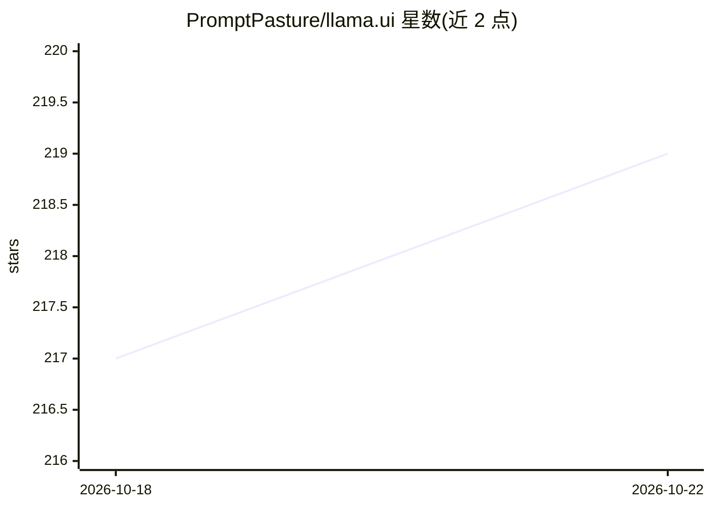

# PromptPasture/llama.ui

⭐ 219 · TypeScript · MIT · 推送 2026-08-17 · [GitHub](https://github.com/PromptPasture/llama.ui) · [官网](https://llama-ui.js.org/) · 组织维护

**浏览器内运行的本地 LLM 聊天 WebUI，对接多种推理后端**

llama.cpp WebUI 的 fork，提供 React + TypeScript 实现的聊天界面：支持 llama.cpp、LM Studio、Ollama、vLLM、OpenAI 等多种推理后端，通过 Base URL 配置接入本地服务器。功能含会话管理（IndexedDB 存储、分支、导入导出）、Markdown/LaTeX 渲染、文件附件、PWA 离线、流式响应与多语言界面；数据全部存于浏览器本地。可使用托管实例零安装，或下载发布包由 llama.cpp server 托管，开发者可用 npm 构建运行。

## 筛选速览

| 维度 | 判定 | 备注 |
|---|---|---|
| AI 角色 | `ai-ecosystem` | LLM/agent 周边工具 |
| 许可风险 | `permissive` | MIT |
| 部署形态 | `desktop` | 安装包/桌面程序 |
| 模型依赖 | local-ok | 支持本地模型 |
| 硬件要求 | — | 无带数字的原话,不猜 |
| 安装摩擦 | `low` | 无编译、无系统依赖或容器化 |
| 成熟度 | — | 结构信号不足 |

## 能力要点

- 多推理后端接入：llama.cpp、LM Studio、Ollama、vLLM、OpenAI 等
- 会话分支编辑、IndexedDB 本地存储、导入导出
- PWA 离线支持与流式响应（SSE）
- 数据全部存储在浏览器本地，无需云端

## 适用场景

- 给本地 llama.cpp / Ollama 服务器配一个聊天界面
- 在浏览器中与本地量化模型对话且不上传数据
- 移动或桌面浏览器随时使用并离线访问（PWA）

## 场景标签

`聊天机器人` · 领域:对话与助手

## 证据(README 行号)

> L3: **Tired of complex AI setups?** 😩 `llama.ui` is an open-source desktop application that provides a beautiful ✨, user
> L17: 1. **Multi-Provider Support**: Works with llama.cpp, LM Studio, Ollama, vLLM, OpenAI,.. and many more!

## 星数曲线

2026-10-18 217 → 2026-10-22 219（+2）

---
*卡片 v1 · prompt 1.4 · 生成 2026-10-22 · 置信度 mid · 依据 README sha `80c69a33de79` · [字段定义](../../DATASET.md)*
