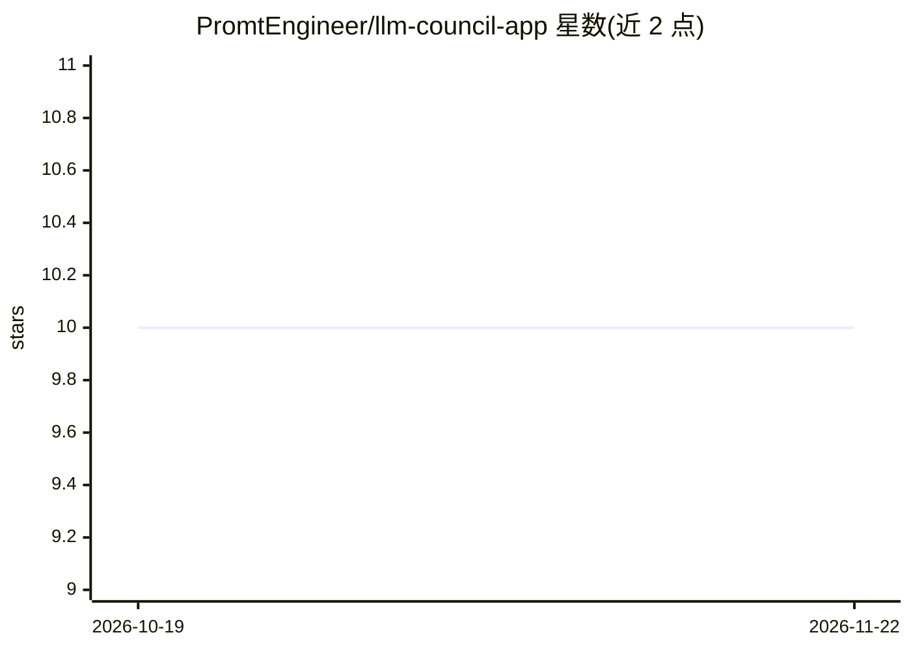

# PromtEngineer/llm-council-app

⭐ 10 · JavaScript · MIT · 推送 2026-06-19 · [GitHub](https://github.com/PromtEngineer/llm-council-app) · 个人维护

**多模型答题互评并合成共识回答的本地 Web 应用**

零依赖的 Node.js 应用，实现 Karpathy 提出的 LLM Council 机制：多个模型依次回答问题，匿名互相排名（Borda 计票），再由主席模型综合共识与异议生成最终回答。所有模型经单一 Vercel AI Gateway 密钥访问，议席角色与模型名单在 config.mjs 配置，可换任意网关路由的模型。v2 加入流式 UI、带独立裁判的两轮评测脚本与网关连通性检查。README 自附的评测结果显示议会在综合类问题上胜出、聚焦类问题上落败。

## 筛选速览

| 维度 | 判定 | 备注 |
|---|---|---|
| AI 角色 | `ai-native` | 本体是模型或模型工具 |
| 许可风险 | `permissive` | MIT |
| 部署形态 | `library` | 以包/库形式分发 |
| 模型依赖 | — | README 未给出锁定关系 |
| 硬件要求 | — | 无带数字的原话,不猜 |
| 安装摩擦 | `low` | 无编译、无系统依赖或容器化 |
| 成熟度 | — | 结构信号不足 |

## 能力要点

- 三阶段编排：回答→匿名互评→Borda 计票→主席合成，带重试
- 单一 Vercel AI Gateway 密钥访问全部模型，换模型只改字符串
- 两套评测脚本：单裁判初评与独立裁判、客观打分的强化评测
- 零 npm 依赖，SSE 流式 vanilla JS UI

## 适用场景

- 让多个模型对同一问题分别作答并互评后给出共识结论
- 对比议会输出与单模型输出以评估是否值得多模型开销
- 需要为每个议席设定不同角色视角进行综合分析

## 场景标签

`多智能体` `模型评测` `聊天机器人` · 领域:Agent 开发

## 证据(README 行号)

> L3: A small, zero-dependency app that runs an **LLM Council** — based on Andrej Karpathy's idea —
> L4: where several models answer a question, anonymously rank each other, and a chairman synthesizes a
> L5: final answer. Every model is reached through **one Vercel AI Gateway key**.

## 星数曲线

2026-10-19 10 → 2026-11-22 10（+0）

---
*卡片 v1 · prompt 1.4 · 生成 2026-11-20 · 置信度 high · 依据 README sha `e64b2fb8c4be` · [字段定义](../../DATASET.md)*
