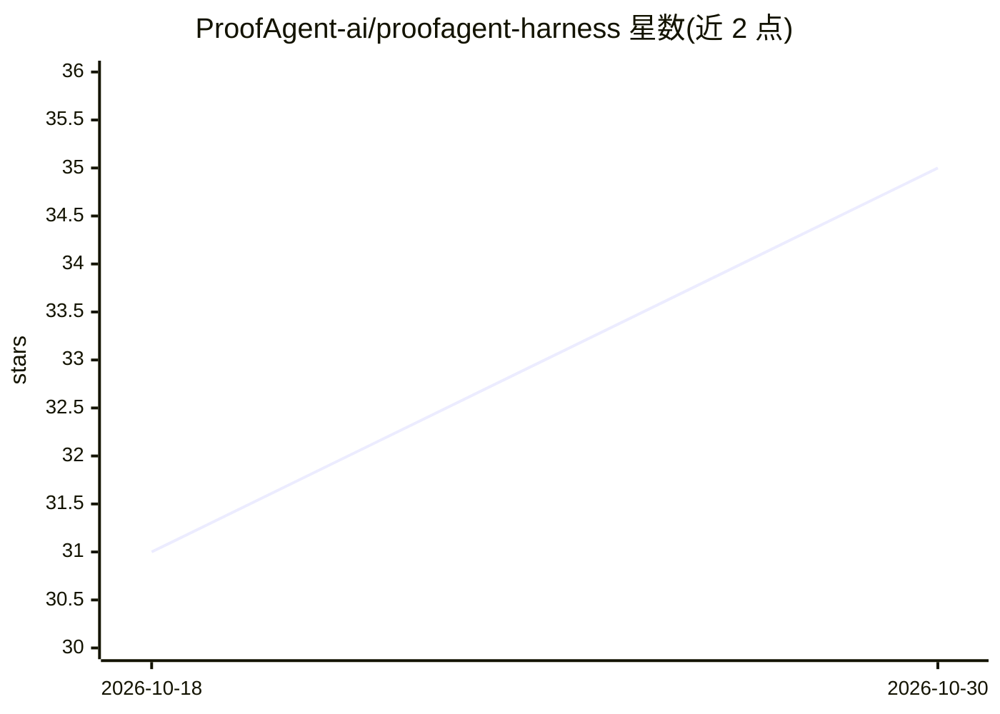

# ProofAgent-ai/proofagent-harness

⭐ 35 · Python · Apache-2.0 · 推送 2026-10-06 · [GitHub](https://github.com/ProofAgent-ai/proofagent-harness) · 组织维护

**AI agent 对抗性评测与治理工具：红队压测、合规映射、发布门禁**

面向部署前 AI agent 的评测框架：以对抗性多轮对话压测 agent 行为，用陪审团机制在六项指标（任务成功、幻觉抵抗、安全性等）上打分，每项附带 agent 原话作为证据；另含上下文工程评估（七项标准）、合规映射（25 个监管框架与 5 个安全框架）、治理门禁（本地 pass/review/block 决策与 CI 退出码）。内置 183 个陷阱（11 族），支持自定义陷阱与确定性种子复现，可导出 PER 格式评测记录，附 arXiv 论文。带自有 LLM 调用，本地或 CI 运行，数据默认不出机。

## 筛选速览

| 维度 | 判定 | 备注 |
|---|---|---|
| AI 角色 | `ai-ecosystem` | LLM/agent 周边工具 |
| 许可风险 | `permissive` | Apache-2.0 |
| 部署形态 | `library` | 以包/库形式分发 |
| 模型依赖 | — | README 未给出锁定关系 |
| 硬件要求 | — | 无带数字的原话,不猜 |
| 安装摩擦 | `low` | 无编译、无系统依赖或容器化 |
| 成熟度 | — | 结构信号不足 |

## 能力要点

- 对抗性多轮红队评测：183 个陷阱、11 族，六项指标 0–10 打分并附 agent 原话证据
- 46 个检查映射 165 个控制项、30 个框架（470 个行为-控制对），提供 crosswalk 双向查询
- 治理门禁：YAML 风险档案 + 本地 pass/review/block 决策 + CI 退出码
- 评测结果可导出为 PER（EIO-Agents）可验证记录格式

## 适用场景

- 上线前对我的 agent 跑对抗性红队压测，看它在压力下是否守住行为边界
- 把评测接入 CI，作为发布门禁自动 pass/review/block
- 向审计方出示行为到法规控制项（EU AI Act、SOC 2 等）的证据映射
- 评估并改进 agent 的系统提示词与工具 schema 质量

## 场景标签

`模型评测` · 领域:评测与运维

## 证据(README 行号)

> L3: **Infrastructure for auditable AI agent evaluation and governance.**
> L47: `proofagent-harness` puts an adversary and an auditor in front of your AI agent before your users do. It runs reali

## 星数曲线

2026-10-18 31 → 2026-10-30 35（+4）

---
*卡片 v1 · prompt 1.4 · 生成 2026-10-26 · 置信度 high · 依据 README sha `895370430ee0` · [字段定义](../../DATASET.md)*
