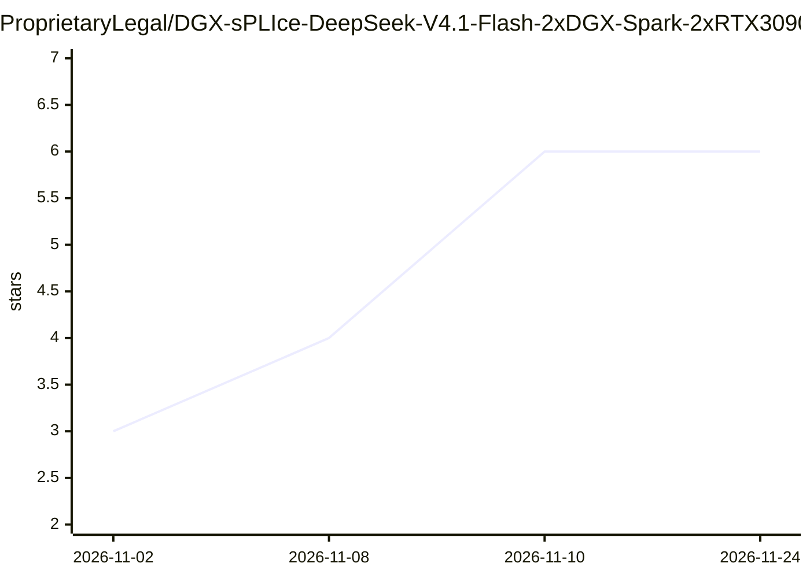

# ProprietaryLegal/DGX-sPLIce-DeepSeek-V4.1-Flash-2xDGX-Spark-2xRTX3090-drafter-x86-offload

⭐ 6 · Python · Apache-2.0 · 推送 2026-11-04 · [GitHub](https://github.com/ProprietaryLegal/DGX-sPLIce-DeepSeek-V4.1-Flash-2xDGX-Spark-2xRTX3090-drafter-x86-offload) · [官网](https://proprietarylegal.ai) · 组织维护

**在 2x DGX Spark + 2x RTX 3090 上本地部署 DeepSeek 的构建与基准记录**

记录作者命名为 DGX sPLIce 的具体推理部署：DeepSeek-V4.1-Flash-1017 以 EXL3 2.75 bpw 量化由 vLLM 在两台 DGX Spark（GB10）节点上张量并行服务，另接一台 x86 机器经 RDMA 提供 Engram 表并在两块 RTX 3090 上运行 DSpark 投机草稿器，释放显存用于约 193 万 token 的 KV 池，并支持 NVMe 持久化前缀层加速重启后的长提示。仓库包含安装指南、测量工具、原始结果文件与质量（KLD/top-1）评估，发布方为一家法律 AI 公司的研究部门。

## 筛选速览

| 维度 | 判定 | 备注 |
|---|---|---|
| AI 角色 | `ai-ecosystem` | LLM/agent 周边工具 |
| 许可风险 | `permissive` | Apache-2.0 |
| 部署形态 | `self-host` | docker 或自建部署 |
| 模型依赖 | local-ok | 支持本地模型 |
| 硬件要求 | — | 无带数字的原话,不猜 |
| 安装摩擦 | `low` | 无编译、无系统依赖或容器化 |
| 成熟度 | — | 结构信号不足 |

## 能力要点

- vLLM 双 DGX Spark 张量并行 + x86 RDMA offload + RTX 3090 草稿器的完整构建方案
- 发布 prefill/decode 吞吐、TTFT、KLD/top-1 一致性等测量数据与原始结果文件
- NVMe 持久化前缀层，150K 提示重启后 2.58 秒读回
- 提供 ghcr.io 容器镜像与分步安装文档

## 适用场景

- 在 DGX Spark 集群上复现该 DeepSeek 长上下文推理部署
- 参照其安装文档与原始数据搭建本地大模型服务
- 对比不同 DGX Spark 构建方案的公开基准数据

## 场景标签

`推理引擎` `模型量化` `模型评测` · 领域:评测与运维

## 证据(README 行号)

> L7: DGX sPLIce (the PLI is Proprietary Legal Intelligence) is our name for this build: DeepSeek V4.1 Flash served across
> L9: DeepSeek-V4.1-Flash-1017 (EXL3, 2.75 bpw) served by vLLM across two NVIDIA DGX Spark / GB10 nodes in tensor parallel
> L61: This repository is DGX sPLIce as it runs in production: every number we measured on it, the tools that measured the

## 星数曲线

2026-11-02 3 → 2026-11-24 6（+3）

---
*卡片 v1 · prompt 1.4 · 生成 2026-11-20 · 置信度 low · 依据 README sha `d5ebdceee18a` · [字段定义](../../DATASET.md)*
