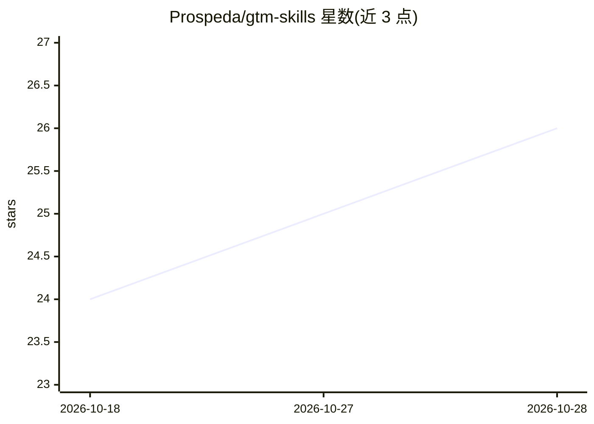

# Prospeda/gtm-skills

⭐ 26 · TypeScript · MIT · 推送 2026-02-03 · [GitHub](https://github.com/Prospeda/gtm-skills) · [官网](https://gtm-skills.com) · 组织维护

**面向 B2B 销售与 GTM 团队的 2,500+ AI 提示词开源库**

按角色（SDR/AE/销售经理/RevOps/CSM/创始人）、行业（SaaS、FinTech 等 15+）、工作流（冷触达到签约全周期）与销售方法论（MEDDPICC、SPIN、Challenger 等）组织的提示词合集，共 2,500+ 条，另含 24 种写作语气指南与 10 个 Claude Projects 系统提示词。提示词可复制到任意 LLM 使用；附带一个 MCP Server（npm 安装），向 Claude Desktop 提供 10 个销售研究/写作工具与 6 个 agentic 工作流。仓库以 MIT 许可发布，关联商业平台 Prospeda。

## 筛选速览

| 维度 | 判定 | 备注 |
|---|---|---|
| AI 角色 | `ai-knowledge` | 知识聚合/清单类 |
| 许可风险 | `permissive` | MIT |
| 部署形态 | `library` | 以包/库形式分发 |
| 模型依赖 | — | README 未给出锁定关系 |
| 硬件要求 | — | 无带数字的原话,不猜 |
| 安装摩擦 | `low` | 无编译、无系统依赖或容器化 |
| 成熟度 | — | 结构信号不足 |

## 能力要点

- 2,500+ 条按角色/行业/工作流/方法论四维组织的提示词
- MCP Server 向 Claude Desktop 提供 research_company、draft_cold_email 等 10 个工具
- 24 种写作语气模板，含使用时机与前后对比示例
- 提供 Agentic BDR Guide 指导构建自主销售 agent

## 适用场景

- 销售团队查找冷邮件、发现通话、异议处理等场景的现成提示词
- 在 Claude Desktop 中通过 MCP 工具做公司调研与邮件起草
- 按行业与方法论（MEDDPICC/SPIN 等）组装销售话术体系

## 场景标签

`提示工程` · 领域:Agent 开发

## 证据(README 行号)

> L5:  2,500+ AI prompts for B2B sales & marketing
> L12:  The most comprehensive open-source library of AI prompts for sales development, account executives, revenue operat
> L149: ## MCP Server

## 星数曲线

2026-10-18 24 → 2026-10-28 26（+2）

---
*卡片 v1 · prompt 1.4 · 生成 2026-10-27 · 置信度 high · 依据 README sha `34e3fc556921` · [字段定义](../../DATASET.md)*
