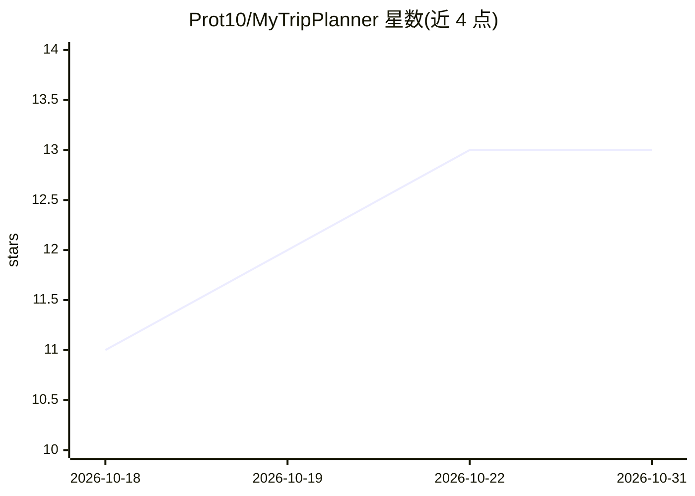

# Prot10/MyTripPlanner

⭐ 13 · JavaScript · NOASSERTION · 推送 2026-10-30 · [GitHub](https://github.com/Prot10/MyTripPlanner) · [官网](https://prot10.github.io/MyTripPlanner/) · 个人维护

**自托管公路旅行规划器：对话式 AI 代理生成真实行程**

自托管的公路旅行规划 Web 应用（React/Vite/Leaflet），内置 AI 旅行代理 Ulisse，通过全屏对话访谈用户后在线生成完整行程：站点、真实道路路线（OSRM）、时间、预算、来自 Booking.com 的真实酒店与 Google Maps 的真实餐厅数据。AI 引擎使用用户自己的 Claude（Agent SDK）或 ChatGPT/Codex 订阅登录，无需 API key。工具调用在浏览器中执行、逐项可回滚，同一工具集也以 MCP over HTTP 暴露。支持多行程管理、预算与燃油估算、照片、i18n（意/英），数据存于本地文件夹。

## 筛选速览

| 维度 | 判定 | 备注 |
|---|---|---|
| AI 角色 | `ai-native` | 本体是模型或模型工具 |
| 许可风险 | `none` | NOASSERTION |
| 部署形态 | `self-host` | docker 或自建部署 |
| 模型依赖 | locked-api |  |
| 硬件要求 | — | 无带数字的原话,不猜 |
| 安装摩擦 | `low` | 无编译、无系统依赖或容器化 |
| 成熟度 | — | 结构信号不足 |

## 能力要点

- 对话式 AI 代理访谈后实时生成完整行程，带反幻觉规则（坐标仅来自地理编码、时长来自真实路由）
- 通过本机 headless Chrome 实时抓取 Booking.com 酒店与 Google Maps 餐厅真实数据，无需 API key
- 30 个专用行程工具以 MCP over HTTP 暴露，任意 MCP 客户端可接入
- 逐回合格式化 diff 与单条/整轮撤销的更改审计

## 适用场景

- 用对话让 AI 帮我规划全程公路旅行，含酒店餐厅与预算
- 自托管、数据不出本机地管理多行程行程单
- 在地图上沿真实道路查看并调整路线与站点

## 场景标签

`聊天机器人` · 领域:对话与助手

## 证据(README 行号)

> L5: **Plan road trips by talking.** Ulisse — an AI agent running on your own Claude or ChatGPT subscription — interviews
> L39: - **In-app chat** (floating panel over the map on desktop, its own tab on mobile) with **two subscription-powered e
> L45: - Architecture: a small local Node server (`server/`) bridges both engines to the open tab over WebSocket; the brow

## 星数曲线

2026-10-18 11 → 2026-10-31 13（+2）

---
*卡片 v1 · prompt 1.4 · 生成 2026-10-31 · 置信度 mid · 依据 README sha `9c29897da83b` · [字段定义](../../DATASET.md)*
