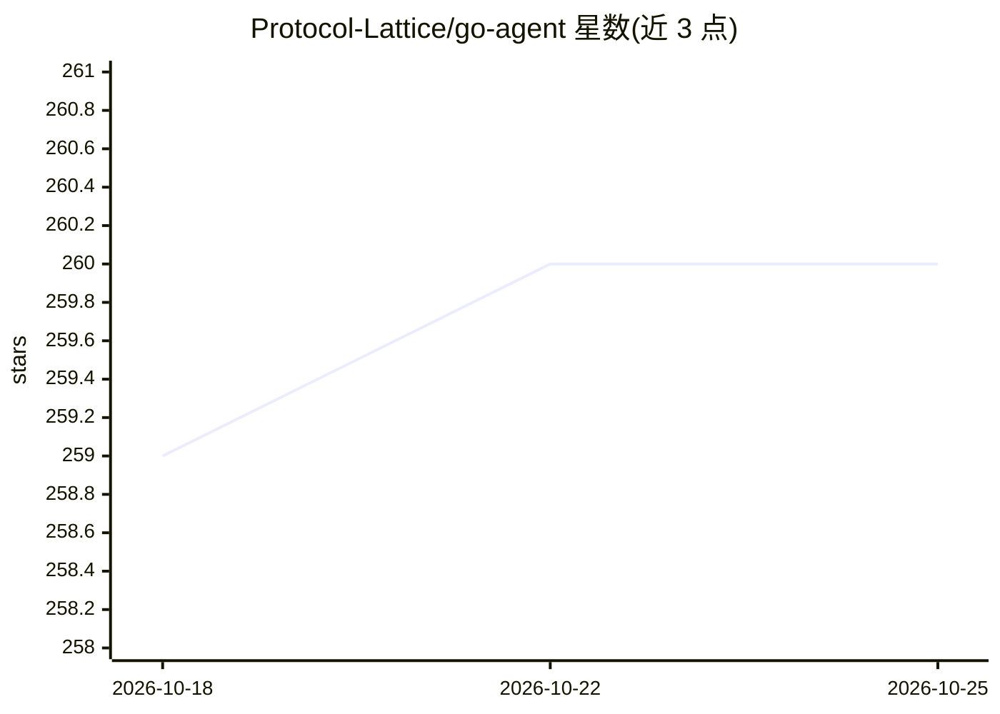

# Protocol-Lattice/go-agent

⭐ 261 · Go · Apache-2.0 · 推送 2026-09-30 · [GitHub](https://github.com/Protocol-Lattice/go-agent) · 组织维护

**Go 语言 AI agent 框架：可插拔 LLM、记忆与多 agent 编排**

面向 Go 开发者的 AI agent 构建框架：提供 agent.Agent 核心（Generate/GenerateWithFiles/GenerateStream）、Gemini/OpenAI/Anthropic/Ollama/OpenRouter 等模型适配器、短期+向量存储长期记忆（Postgres/pgvector、Qdrant、MongoDB、Neo4j）、UTCP 工具编排、输入输出 guardrails、检查点恢复、图工作流与 at-least-once 持久化执行，以及 CodeMode 代码工具编排（需启用 AllowUnsafeTools，仅限可信环境）。通过 go get 安装，目标 Go 1.25.10，附无需 API key 的示例。

## 筛选速览

| 维度 | 判定 | 备注 |
|---|---|---|
| AI 角色 | `ai-ecosystem` | LLM/agent 周边工具 |
| 许可风险 | `permissive` | Apache-2.0 |
| 部署形态 | `None` |  |
| 模型依赖 | local-ok | 支持本地模型 |
| 硬件要求 | — | 无带数字的原话,不猜 |
| 安装摩擦 | `low` | 无编译、无系统依赖或容器化 |
| 成熟度 | — | 结构信号不足 |

## 能力要点

- 多 provider 适配器（Gemini/OpenAI/Anthropic/Ollama/OpenRouter）与本地 dummy 模型
- 向量存储长期记忆支持 In-memory/Postgres+pgvector/Qdrant/MongoDB/Neo4j
- 图工作流与 RunStore 持久化（at-least-once，节点需幂等）
- guardrails、checkpoint/restore、重试/限流/token 预算中间件

## 适用场景

- 用 Go 构建接入多种 LLM 的生产级 agent 应用
- 需要持久化记忆与检查点恢复的长周期 agent 工作流
- 通过 UTCP 与 CodeMode 做跨进程工具编排

## 场景标签

`Agent 框架` `Agent 记忆` `多智能体` · 领域:Agent 开发

## 证据(README 行号)

> L8: go-agent is a Go framework for building AI agents with pluggable LLM providers, memory, file context, guardrails, UT
> L13: - Provider adapters for Gemini, OpenAI, Anthropic, Ollama, and a local dummy model

## 星数曲线

2026-10-18 259 → 2026-10-25 260（+1）

---
*卡片 v1 · prompt 1.4 · 生成 2026-10-22 · 置信度 high · 依据 README sha `8717fdfe8e14` · [字段定义](../../DATASET.md)*
