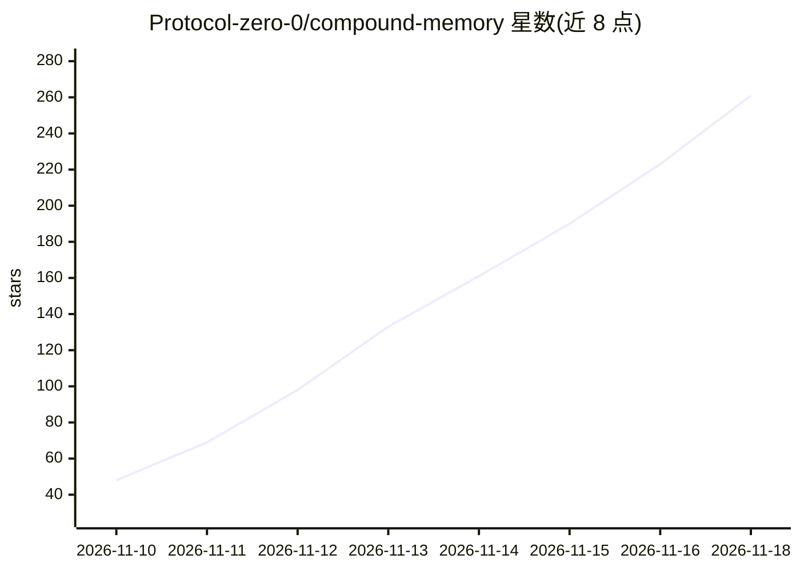

# Protocol-zero-0/compound-memory

⭐ 261 · Python · MIT · 推送 2026-10-26 · [GitHub](https://github.com/Protocol-zero-0/compound-memory) · 个人维护 · 中文 README

**给 Claude Code/Codex 等编程 agent 的跨会话长期记忆工具**

后台进程每晚读取本机 AI 会话原文（Claude Code、Codex CLI、DeepSeek Harness 的 JSONL 记录），提炼成关于用户偏好、决定与未完事项的记忆快照，通过 hook 或 AGENTS.md 在每个新会话开局自动注入，支持多机经私有 GitHub 仓库或飞书共享。本地优先，原文不出机，出机记忆逐条判定并清洗密钥；LLM 后端默认本机 claude 命令，可换任何 OpenAI 兼容接口。提供 cm recall 检索、cm eval 回测、导入旧数据与卸载命令。

## 筛选速览

| 维度 | 判定 | 备注 |
|---|---|---|
| AI 角色 | `ai-ecosystem` | LLM/agent 周边工具 |
| 许可风险 | `permissive` | MIT |
| 部署形态 | `library` | 以包/库形式分发 |
| 模型依赖 | locked-api |  |
| 硬件要求 | — | 无带数字的原话,不猜 |
| 安装摩擦 | `low` | 无编译、无系统依赖或容器化 |
| 成熟度 | — | 结构信号不足 |

## 能力要点

- 每晚自动读会话原文、提炼、更新记忆快照并在新会话开局注入
- 支持 Claude Code/Codex CLI/DeepSeek Harness 三类 harness，新增只需写一个 sources 模块
- 共享层可选本地/私有 GitHub 仓库/飞书，出机记忆逐条判定并清洗密钥
- 旧记忆改主意后自动失效，带 cm eval 回测提示词改动

## 适用场景

- 换机器、换工具、换模型后不用重新向 AI 解释自己的偏好和背景
- 在工作中按话题翻找此前会话里的决定和未完线头（带出处）
- 多台机器之间共用同一份 agent 记忆

## 场景标签

`Agent 记忆` · 领域:Agent 开发

## 证据(README 行号)

> L37: - **不用你做任何事。** 每晚自动读会话、提炼、写快照,你只管正常用 AI。
> L90: |**Claude Code**|`~/.claude/projects/**/*.jsonl`|`settings.json` 的 `SessionStart` hook|✅ 已验证|
> L94: 再加一个 harness = 写一个 `cm/sources/<名字>.py`,提供 `available / scan / load_turns` 三个函数。

## 星数曲线

2026-11-10 48 → 2026-11-18 261（+213）

---
*卡片 v1 · prompt 1.4 · 生成 2026-11-17 · 置信度 mid · 依据 README sha `4853adf5ded0` · [字段定义](../../DATASET.md)*
