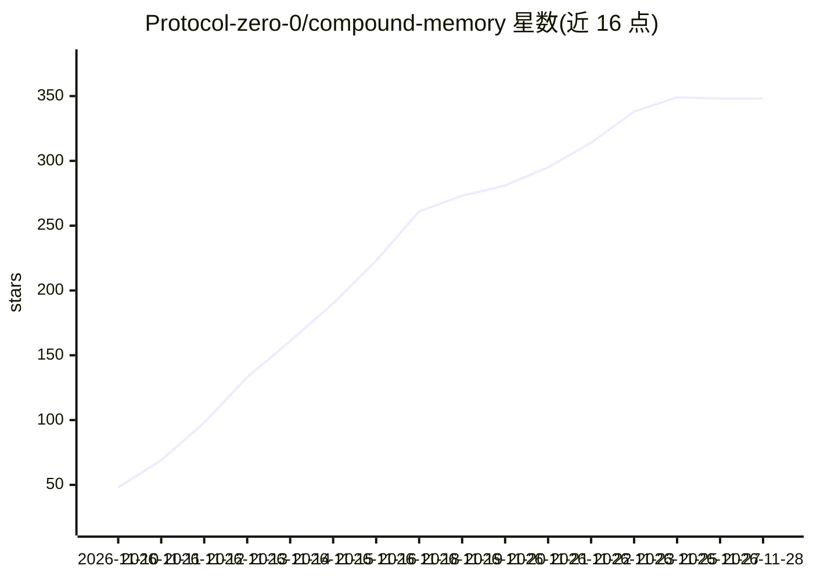

# Protocol-zero-0/compound-memory

⭐ 348 · Python · MIT · 推送 2026-11-25 · [GitHub](https://github.com/Protocol-zero-0/compound-memory) · 个人维护 · 中文 README

**为 Claude Code/Codex 等编码 agent 提供跨会话跨机器长期记忆**

本地运行的 agent 记忆工具：夜间自动读取 Claude Code、Codex CLI、DeepSeek Harness、Antigravity CLI 的会话记录，用 LLM 蒸馏为偏好、决策与待办记忆，生成快照并在新会话开始时注入上下文，可随时用 cm recall 带出处检索。支持 github/feishu 作为共享层实现多机同步；记录仅本地保存，共享条目逐条判定并清理秘密。需一个可调用的模型（默认 claude CLI，或任意 OpenAI 兼容端点），Python 3.9+、零依赖，通过 git clone 加 install.sh 安装。

## 筛选速览

| 维度 | 判定 | 备注 |
|---|---|---|
| AI 角色 | `ai-ecosystem` | LLM/agent 周边工具 |
| 许可风险 | `permissive` | MIT |
| 部署形态 | `library` | 以包/库形式分发 |
| 模型依赖 | locked-api |  |
| 硬件要求 | — | 无带数字的原话,不猜 |
| 安装摩擦 | `low` | 无编译、无系统依赖或容器化 |
| 成熟度 | — | 结构信号不足 |

## 能力要点

- 夜间自动读取会话记录并蒸馏为带过期机制的快照记忆
- 支持 Claude Code / Codex / DeepSeek Harness / Antigravity CLI 四种 harness
- 多机共享：github 私有仓库或飞书作为 sink
- 共享层逐条隐私判定，导出前清理秘密，附全局推送门控工具

## 适用场景

- 新会话不用再重新介绍自己，AI 自动带上我的偏好和历史决策
- 多台机器上的编码 agent 共享同一份长期记忆
- 把散落在旧会话里的未完成事项整理成可检索的记忆库

## 场景标签

`Agent 记忆` · 领域:Agent 开发

## 证据(README 行号)

> L3: compound-memory: Long-Term Memory for Coding Agents
> L41: - **Works across tools and machines.** Claude Code, Codex and DeepSeek Harness share one memory.
> L92: |Harness|Reads transcripts from|Session-start injection|Status|

## 星数曲线

2026-11-10 48 → 2026-11-28 348（+300）

---
*卡片 v1 · prompt 1.4 · 生成 2026-11-26 · 置信度 mid · 依据 README sha `745f97a9e09b` · [字段定义](../../DATASET.md)*
