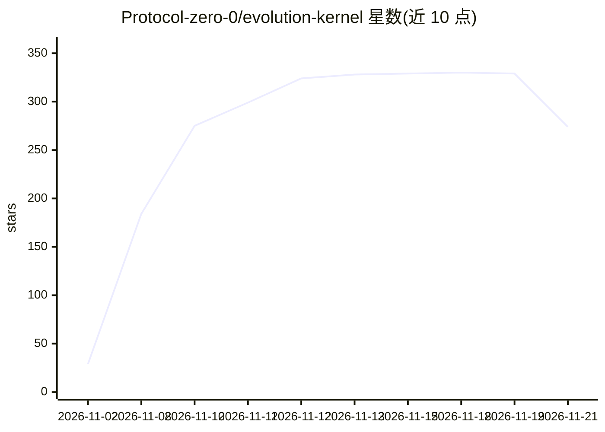

# Protocol-zero-0/evolution-kernel

⭐ 274 · Python · MIT · 推送 2026-11-03 · [GitHub](https://github.com/Protocol-zero-0/evolution-kernel) · [官网](https://evolution-kernel.joulebeat.com/) · 个人维护 · 中文 README

**开源进化循环内核：让编码 agent 按可测目标自我改进任意 git 仓库**

面向任意 git 仓库的自改进运行时：设定可测量目标后循环执行观察（运行指标命令或拉取 HTTP 端点状态）→规划（LLM 读取指标与历史）→执行（Aider 或 Claude Code 在隔离 git worktree + firejail 沙箱中改代码）→评估（LLM 决定接受或回滚），接受者成为真实 git commit。全程写入可审计 ledger，支持预算硬停（USD/token）、k 分支并行探索与空模型对照检验。单一运行时依赖 PyYAML，Python ≥3.10；README 明示 SWE-bench 走廊为推演目标而非实测结果。

## 筛选速览

| 维度 | 判定 | 备注 |
|---|---|---|
| AI 角色 | `ai-ecosystem` | LLM/agent 周边工具 |
| 许可风险 | `permissive` | MIT |
| 部署形态 | `library` | 以包/库形式分发 |
| 模型依赖 | locked-api |  |
| 硬件要求 | — | 无带数字的原话,不猜 |
| 安装摩擦 | `low` | 无编译、无系统依赖或容器化 |
| 成熟度 | `idea` | |

## 能力要点

- Observe→Plan→Execute→Evaluate→Commit/rollback 闭环循环
- Aider 与 Claude Code 执行器适配器，Anthropic/OpenAI 规划与评估适配器
- 每步写入 ledger 审计记录，回滚即 git reset 到基线 commit
- max_total_usd / max_total_tokens 预算守卫与 firejail OS 级沙箱

## 适用场景

- 让小参数模型配合进化出的 harness 追近前沿模型在基准上的表现
- 对自有代码仓库按可测指标自动提出并筛选改进提交
- 需要全程可审计、可回滚的自动化代码实验流水线

## 场景标签

`编码 Agent` · 领域:编码与开发

## 证据(README 行号)

> L76: Point Evolution Kernel at any git repository and give it a measurable goal. It runs a closed loop:
> L82: |🔨 **Execute**|Coding agent (Aider or Claude Code) applies the plan inside an isolated git worktree, wrapped in a f
> L83: |⚖️ **Evaluate**|Re-run your metric; LLM decides accept or reject|

## 星数曲线

2026-11-02 29 → 2026-11-21 274（+245）

---
*卡片 v1 · prompt 1.4 · 生成 2026-11-17 · 置信度 high · 依据 README sha `bd45f224a9a3` · [字段定义](../../DATASET.md)*
