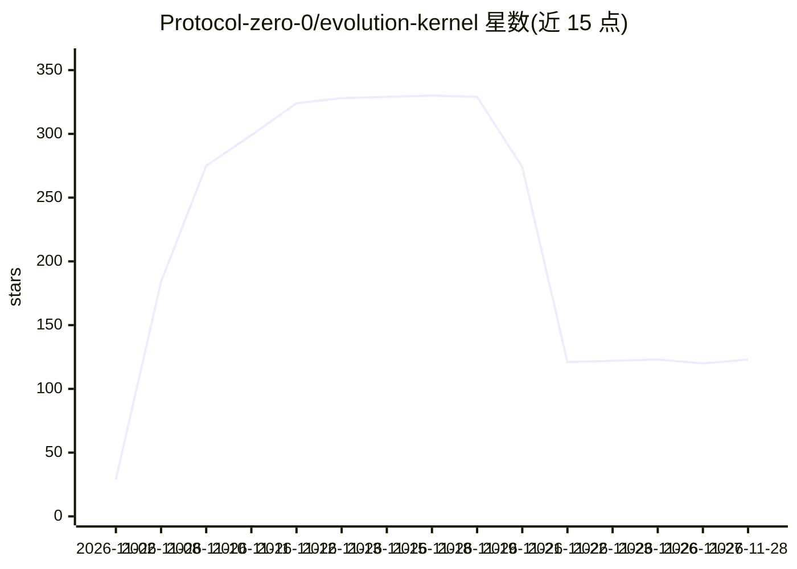

# Protocol-zero-0/evolution-kernel

⭐ 123 · Python · MIT · 推送 2026-11-25 · [GitHub](https://github.com/Protocol-zero-0/evolution-kernel) · [官网](https://evolution-kernel.joulebeat.com/) · 个人维护 · 中文 README

**给 git 仓库运行自动改进进化循环：Agent 提改、评分留优汰劣**

面向任意 git 仓库的自动化改进运行时：用户提供可度量的目标，由 LLM 规划、编码 Agent（Aider 或 Claude Code）在隔离 git worktree 与 firejail 沙箱内执行修改，再依据指标重跑结果由 LLM 判定接受或回滚；每次尝试写入完整 ledger，接受项为可回滚的 git 提交。核心 Governor 为零 LLM 调用的编排层，三个角色脚本可替换。支持预算硬停（美元/Token/迭代数）与空模型消融对照门禁。安装后 Python ≥ 3.10，运行时仅依赖 PyYAML。

## 筛选速览

| 维度 | 判定 | 备注 |
|---|---|---|
| AI 角色 | `ai-ecosystem` | LLM/agent 周边工具 |
| 许可风险 | `permissive` | MIT |
| 部署形态 | `library` | 以包/库形式分发 |
| 模型依赖 | locked-api |  |
| 硬件要求 | — | 无带数字的原话,不猜 |
| 安装摩擦 | `low` | 无编译、无系统依赖或容器化 |
| 成熟度 | — | 结构信号不足 |

## 能力要点

- Observe→Plan→Execute→Evaluate 闭环，k 分支并行探索（FunSearch/AlphaEvolve 式）
- 每次尝试记录完整 ledger，所有决策可从 ledger 重建
- git worktree + firejail 双层沙箱，scope 强制限定 allowed_paths
- 预算硬停与空模型消融对照，避免只优化指标本身

## 适用场景

- 给自己的 agent 项目自动进化 harness 并保留可审计记录
- 在预算上限内让编码 Agent 持续尝试优化指定指标
- 对同一模型批量产出可迁移到同参数级模型的 harness

## 场景标签

`编码 Agent` `Agent 框架` · 领域:Agent 开发

## 证据(README 行号)

> L82: |🔨 **Execute**|Coding agent (Aider or Claude Code) applies the plan inside an isolated git worktree, wrapped in a f
> L101: |Anthropic and OpenAI planner/evaluator adapters|✅|

## 星数曲线

2026-11-02 29 → 2026-11-28 123（+94）

---
*卡片 v1 · prompt 1.4 · 生成 2026-11-28 · 置信度 high · 依据 README sha `0fca2c29121c` · [字段定义](../../DATASET.md)*
