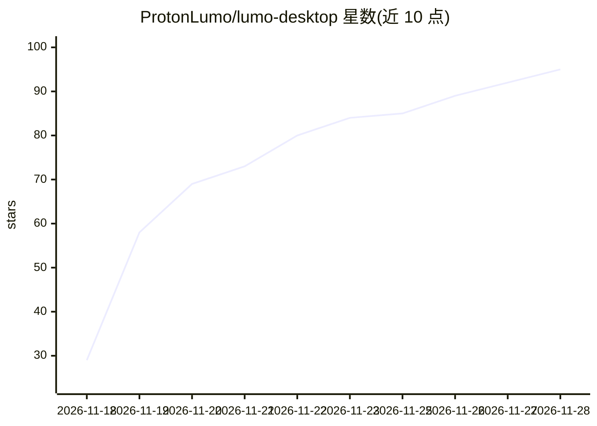

# ProtonLumo/lumo-desktop

⭐ 95 · Rust · GPL-3.0 · 推送 2026-11-26 · [GitHub](https://github.com/ProtonLumo/lumo-desktop) · [官网](https://proton.me/blog/lumo-desktop-features) · 组织维护

**Proton 隐私优先 AI 助手 Lumo 的桌面客户端**

由 Proton 维护的桌面应用，用 Tauri 原生壳封装远程加载的 Lumo AI 助手网页应用，覆盖 macOS/Windows/Linux。核心功能是通过连接器让 AI 助手访问本地与外部工具：读写本地文件、执行 shell 命令、读取网页、Proton Mail、Luminance 及任意 MCP 服务器（预置 GitHub、Linear、Figma、Stripe 等目录）。每个工具可设为自动批准、询问或禁用；OAuth 令牌与密钥存于 OS 钥匙串；登录通过用户自有浏览器完成以支持安全密钥。需登录 Proton 账户使用。

## 筛选速览

| 维度 | 判定 | 备注 |
|---|---|---|
| AI 角色 | `ai-native` | 本体是模型或模型工具 |
| 许可风险 | `viral` | GPL-3.0 |
| 部署形态 | `desktop` | 安装包/桌面程序 |
| 模型依赖 | — | README 未给出锁定关系 |
| 硬件要求 | — | 无带数字的原话,不猜 |
| 安装摩擦 | `low` | 无编译、无系统依赖或容器化 |
| 成熟度 | — | 结构信号不足 |

## 能力要点

- 连接器让 AI 助手读写本地文件、执行 shell、使用 Proton Mail/Luminance/任意 MCP 服务器
- 每工具三档批准策略（auto-approve/ask/disabled），ask 状态挂起等待用户答复
- 凭据存于 OS 钥匙串，登录经用户自有浏览器支持安全密钥/通行密钥
- 全局快捷键 Quick ask 与定时提示任务

## 适用场景

- 在桌面端使用 Proton 的隐私优先 AI 助手 Lumo
- 让 AI 助手在批准控制下操作本地文件、命令行与 MCP 工具
- 从任意位置通过全局快捷键快速提问

## 场景标签

`AI 助手` · 领域:对话与助手

## 证据(README 行号)

> L5:  The desktop app for Lumo, Proton's privacy-first AI assistant.
> L8: Lumo Desktop wraps the Lumo web app in a native Tauri shell and gives it access to your
> L11: - **Connectors**: let Lumo read and edit local files, run shell commands, and use Proton Mail, Luminance, and

## 星数曲线

2026-11-18 29 → 2026-11-28 95（+66）

---
*卡片 v1 · prompt 1.4 · 生成 2026-11-18 · 置信度 high · 依据 README sha `028cd1932549` · [字段定义](../../DATASET.md)*
