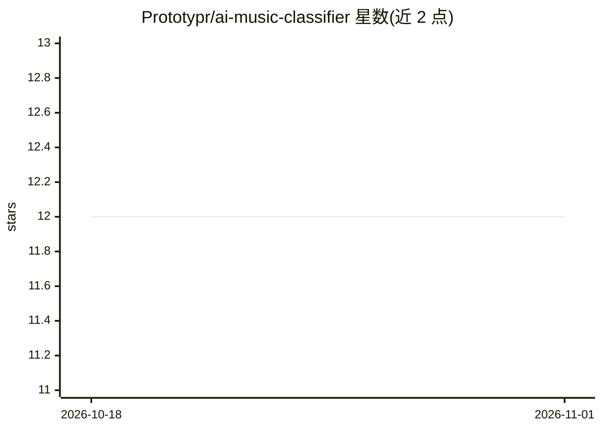

# Prototypr/ai-music-classifier

⭐ 12 · Python · MIT · 推送 2026-07-03 · [GitHub](https://github.com/Prototypr/ai-music-classifier) · [官网](https://soullessmusic.com) · 组织维护

**检测音频是否为 AI 生成的 FastAPI 分类服务**

soullessmusic.com 背后的开源 AI 音乐检测器：输入音频 URL（30 秒预览即可），返回 Human/Processed-AI/Pure-AI 判定、各检测器信号，以及生成器版本归因（Suno v2–v5.5、Udio）。机制为三个检测器（SONICS 双模型、vocoder 伪影 ONNX 模型、元数据扫描）经 noisy-OR 佐证规则融合；版本头用 PCA+逻辑回归。首次运行从 Hugging Face 下载约 2.9 GB 权重后可完全离线，CPU-only。不存储也不使用人类音乐训练。

## 筛选速览

| 维度 | 判定 | 备注 |
|---|---|---|
| AI 角色 | `ai-native` | 本体是模型或模型工具 |
| 许可风险 | `permissive` | MIT |
| 部署形态 | `self-host` | docker 或自建部署 |
| 模型依赖 | — | README 未给出锁定关系 |
| 硬件要求 | `cpu-ok` | |
| 安装摩擦 | `low` | 无编译、无系统依赖或容器化 |
| 成熟度 | — | 结构信号不足 |

## 能力要点

- 三检测器融合（SONICS / vocoder 伪影 / 元数据扫描）输出三元判定
- 开放集版本归因：Suno v2–v5.5 与 Udio，低置信返回 uncertain
- 首次下载 ~2.9 GB 权重后完全离线、CPU-only 运行
- 提供版本头再训练脚本与环境变量调参项

## 适用场景

- 给定歌曲试听链接判断是否 AI 生成
- 区分纯 AI、AI 处理与人类创作，并识别生成器版本
- 在自有硬件上离线批量检测，不向第三方发送音频

## 场景标签

 · 领域:音频 AI 检测

## 证据(README 行号)

> L4: "Is this song AI?" detector. A small FastAPI service: give it an audio URL
> L5: (a 30-second store preview is enough), it returns a **Human / Processed-AI /
> L6: Pure-AI** verdict, per-detector signals, and an open-set guess at which

## 星数曲线

2026-10-18 12 → 2026-11-01 12（+0）

---
*卡片 v1 · prompt 1.4 · 生成 2026-11-01 · 置信度 high · 依据 README sha `74a34de99eb9` · [字段定义](../../DATASET.md)*
