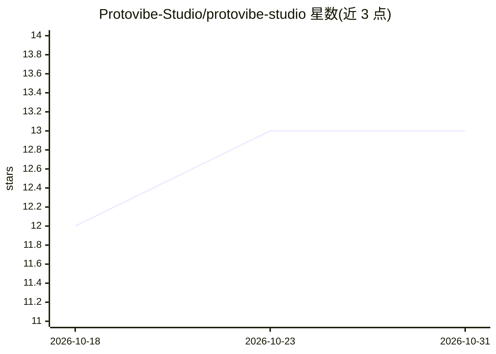

# Protovibe-Studio/protovibe-studio

⭐ 13 · TypeScript · AGPL-3.0 · 推送 2026-10-29 · [GitHub](https://github.com/Protovibe-Studio/protovibe-studio) · [官网](https://protovibe-studio.github.io/) · 组织维护

**面向 React+Tailwind 的可视化 Web 构建器，可搭配自有 AI agent**

Protovibe Studio 是一个可视化编辑的 Web 构建工具，用于快速创建与编辑 React + Tailwind 项目，用户可接入自己的 AI agent 参与开发。仓库为 monorepo：protovibe-project-manager 是 React+Vite 主界面，通过 REST/SSE API 拉起并监控各项目的 dev server；新项目复制预置模板（含 vite-plugin-protovibe 插件，经 pnpm link 符号链接消费）。提供 macOS/Linux/Windows 安装脚本与自更新脚本，非技术用户可免终端安装。采用 AGPLv3 + 商业双许可，生成物归用户所有。

## 筛选速览

| 维度 | 判定 | 备注 |
|---|---|---|
| AI 角色 | `ai-enhanced` | 去掉 AI 部分产品仍成立 |
| 许可风险 | `dual` | AGPL-3.0 |
| 部署形态 | `library` | 以包/库形式分发 |
| 模型依赖 | — | README 未给出锁定关系 |
| 硬件要求 | — | 无带数字的原话,不猜 |
| 安装摩擦 | `low` | 无编译、无系统依赖或容器化 |
| 成熟度 | — | 结构信号不足 |

## 能力要点

- React+Vite 项目管理器经 REST/SSE API 拉起并监控各项目 dev server
- 项目模板内置 vite-plugin-protovibe 插件，pnpm link 符号链接、改插件即时生效
- 跨平台安装脚本（含无 sudo 装 Node、Windows 自动提权、/UNATTENDED 无人值守）与自更新脚本
- AGPLv3 + 商业双许可，输出物（UI 设计/导出 HTML/CSS/JSON）不受 AGPL 约束

## 适用场景

- 可视化搭建并运行多个 React + Tailwind 项目
- 搭配自己的 AI agent 快速创建和编辑 Web 项目
- 非技术用户通过安装包免终端使用

## 场景标签

 · 领域:Web 开发/可视化构建工具

## 证据(README 行号)

> L3: A visual editor web builder for React + Tailwind apps for rapidly creating and editing web projects with your own AI
> L60: The repo also ships its own end-user installers and a desktop shortcut builder, so non-technical users can get Prot

## 星数曲线

2026-10-18 12 → 2026-10-31 13（+1）

---
*卡片 v1 · prompt 1.4 · 生成 2026-10-31 · 置信度 mid · 依据 README sha `e5efbde4a243` · [字段定义](../../DATASET.md)*
