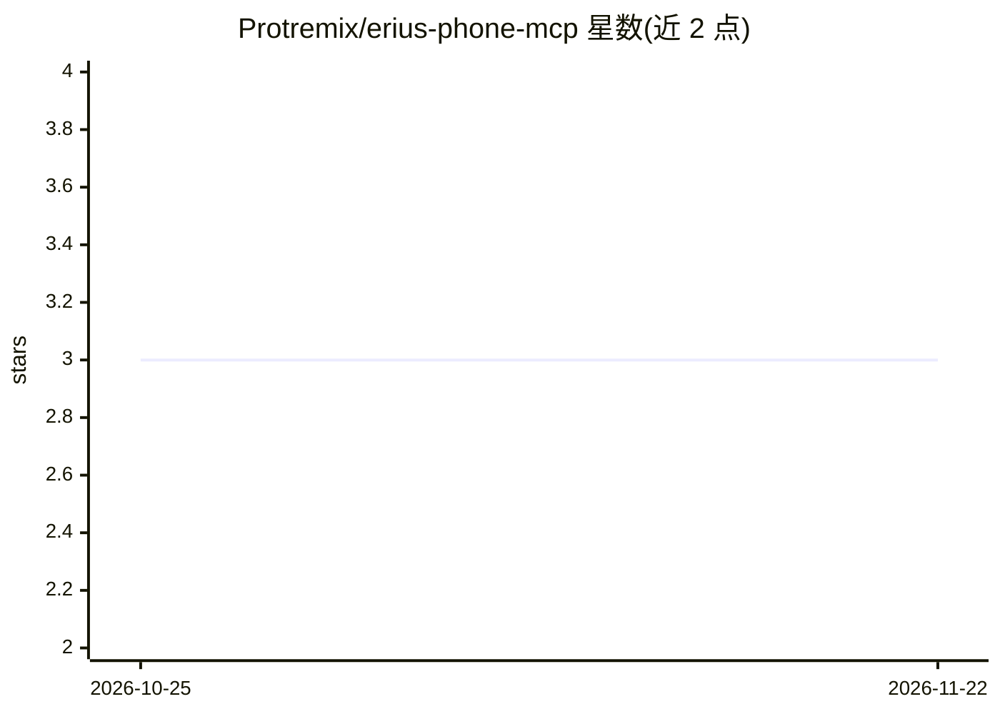

# Protremix/erius-phone-mcp

⭐ 3 · Python · MIT · 推送 2026-10-13 · [GitHub](https://github.com/Protremix/erius-phone-mcp) · [官网](https://eriusphone.com) · 组织维护

**让 AI agent 通过 MCP 控制真实 Android 手机的服务器**

一个 MCP 服务器，将 ERIUS PHONE 设备（专属的 Android 手机/平板，云端 redroid 实例）封装为一组原生工具，供 Claude Code、Claude Desktop、Cursor 等任何 MCP 客户端调用。工具覆盖设备列表、无障碍树/截图读取、点击/长按/输入/滑动/滚动、应用启动与停止、URL 与 intent、APK 安装卸载、崩溃日志读取。通过环境变量配置 API key，stdio 通信，Python 3.10+，支持 uvx 或 pip 安装。限制包括 ASCII-only 输入、速率限制、pre-1.0 接口可能变动。

## 筛选速览

| 维度 | 判定 | 备注 |
|---|---|---|
| AI 角色 | `ai-ecosystem` | LLM/agent 周边工具 |
| 许可风险 | `permissive` | MIT |
| 部署形态 | `library` | 以包/库形式分发 |
| 模型依赖 | — | README 未给出锁定关系 |
| 硬件要求 | — | 无带数字的原话,不猜 |
| 安装摩擦 | `low` | 无编译、无系统依赖或容器化 |
| 成熟度 | `idea` | |

## 能力要点

- 以无障碍树 snapshot + ref 定位的屏幕读取与操作工具集
- 截图以 MCP image content 返回，模型可直接看到屏幕
- 读取崩溃日志（logcat -b crash）辅助 QA 排查
- 支持 Claude Code / Claude Desktop / Cursor 及任意 stdio MCP 客户端

## 适用场景

- 让 agent 代为操作 Android 手机完成日常任务
- 移动应用 QA：安装 APK、遍历界面、读取崩溃日志
- 通过自然语言驱动真机做 UI 自动化验证

## 场景标签

`GUI 自动化` · 领域:效率与自动化

## 证据(README 行号)

> L5: An MCP server that turns your
> L7: Claude Desktop, Cursor, or any other MCP client. An ERIUS PHONE device is a real
> L18: The agent drives the device directly. You don't write any glue code.

## 星数曲线

2026-10-25 3 → 2026-11-22 3（+0）

---
*卡片 v1 · prompt 1.4 · 生成 2026-11-22 · 置信度 high · 依据 README sha `4bbcbba8b798` · [字段定义](../../DATASET.md)*
