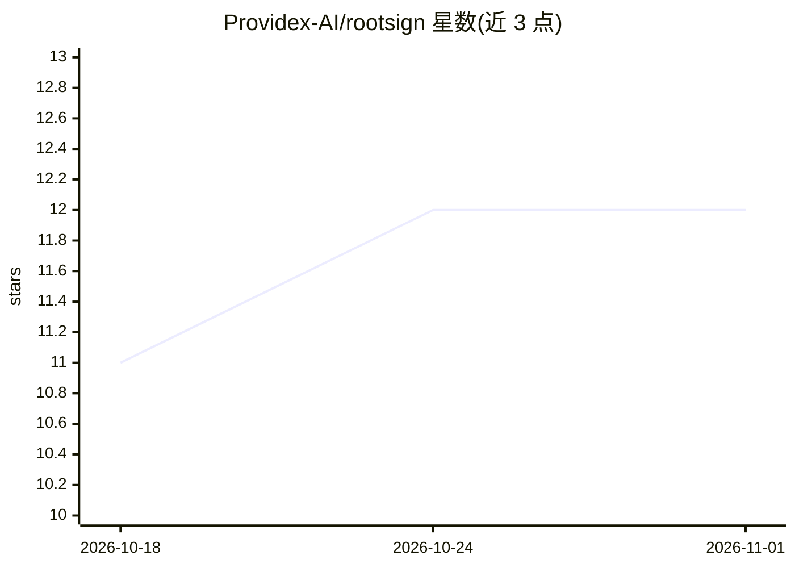

# Providex-AI/rootsign

⭐ 12 · Python · Apache-2.0 · 推送 2026-10-30 · [GitHub](https://github.com/Providex-AI/rootsign) · [官网](https://getprovidex.com) · 组织维护

**给生产环境 AI agent 的防篡改行为审计日志库**

面向生产环境 AI agent 的行为溯源记录库：以装饰器 @rootsign.trace 或 wrap_tools() 包裹工具调用，每个 Action 记录含前一条记录的 SHA-256 哈希形成密码学哈希链，rootsign verify CLI 可检测事后篡改（退出码区分 VALID/TAMPERED/INCOMPLETE）。默认 JSONL 后端零依赖，可切换 Postgres/TimescaleDB。提供 LangGraph/CrewAI 集成、框架无关的 MCP 代理、PII 脱敏、human-in-the-loop 审批、决策捕获（opt-in）与 rootsign export 证据包。它是 Providex AI Agent Accountability Platform 的采集层，Python 3.11+。

## 筛选速览

| 维度 | 判定 | 备注 |
|---|---|---|
| AI 角色 | `ai-ecosystem` | LLM/agent 周边工具 |
| 许可风险 | `permissive` | Apache-2.0 |
| 部署形态 | `self-host` | docker 或自建部署 |
| 模型依赖 | — | README 未给出锁定关系 |
| 硬件要求 | — | 无带数字的原话,不猜 |
| 安装摩擦 | `low` | 无编译、无系统依赖或容器化 |
| 成熟度 | — | 结构信号不足 |

## 能力要点

- SHA-256 哈希链使 Action 记录防篡改，verify CLI 区分篡改与丢失
- 默认 JSONL 后端无需数据库/Docker，三个调用即可接入
- LangGraph/CrewAI 集成与框架无关的 MCP 代理
- PII 脱敏在哈希前执行，另有人工审批门控与证据包导出

## 适用场景

- 生产 agent 出错后证明其执行了什么操作、顺序与授权情况
- 高风险工具调用前插入人工审批检查点
- 向合规人员导出可浏览器打开的会话证据包

## 场景标签

`LLM 可观测性` · 领域:评测与运维

## 证据(README 行号)

> L18: > *RootSign is a Providex AI product — the agent capture layer of the Providex AI Agent Accountability Platform.*
> L22: RootSign solves this. Each agent action is captured as an `Action` record containing a SHA-256 hash of the previous

## 星数曲线

2026-10-18 11 → 2026-11-01 12（+1）

---
*卡片 v1 · prompt 1.4 · 生成 2026-11-01 · 置信度 mid · 依据 README sha `b25b70057c42` · [字段定义](../../DATASET.md)*
