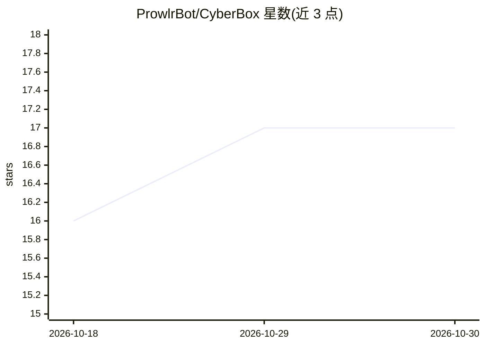

# ProwlrBot/CyberBox

⭐ 17 · Python · Apache-2.0 · 推送 2026-09-28 · [GitHub](https://github.com/ProwlrBot/CyberBox) · [官网](https://prowlrbot.com) · 组织维护

**面向渗透测试者的加固 Docker 安全工作区，内置双 AI 分析**

Docker 化的漏洞赏金与攻击性安全研究沙箱：镜像含 160+ 安全工具、Metasploit、Ollama 客户端与字典卷；配套 Caido 代理插件 Prowlr（作用域强制、Claude+Ollama 双 LLM 分析、xterm.js 终端、Obsidian 导出）、自主侦察-扫描-报告流水线 prowl、插件管理器 csbx（社区注册表 + pdtm 格式 Go 工具安装）。安全机制包括 cosign 签名/SBOM/SLSA 溯源、SSRF 白名单、7 种提示注入过滤与 6 类密钥脱敏。AI 为其中的分析功能，去掉后沙箱与工具集仍可运行。

## 筛选速览

| 维度 | 判定 | 备注 |
|---|---|---|
| AI 角色 | `ai-enhanced` | 去掉 AI 部分产品仍成立 |
| 许可风险 | `permissive` | Apache-2.0 |
| 部署形态 | `desktop` | 安装包/桌面程序 |
| 模型依赖 | local-ok | 支持本地模型 |
| 硬件要求 | — | 无带数字的原话,不猜 |
| 安装摩擦 | `low` | 无编译、无系统依赖或容器化 |
| 成熟度 | — | 结构信号不足 |

## 能力要点

- 160+ 安全工具的加固 Docker 镜像，cosign 签名 + SBOM + SLSA 溯源
- Claude + Ollama 双 LLM 分析，统一 CLI 封装 invoke-claude/invoke-ollama
- Prowlr Caido 插件提供作用域强制、Obsidian 发现导出与 NemoClaw 式护栏
- csbx 插件市场支持社区注册表与 pdtm 格式 Go 工具安装

## 适用场景

- 在可验证供应链的隔离环境中运行渗透测试与漏洞赏金任务
- 通过 Caido 代理对流量做双 LLM AI 分析并导出 Obsidian 报告
- 用 prowl CLI 跑自主侦察-扫描-报告流水线
- 按需从社区注册表安装额外安全工具与字典

## 场景标签

`网络安全` · 领域:学习与行业

## 证据(README 行号)

> L39: CyberBox pairs a hardened sandbox container with **Prowlr** (a Caido proxy plugin), **prowl** (autonomous hunt pipe
> L45: |**cybersandbox**|Docker image with 160+ security tools, Ollama client, Metasploit, mounted wordlists volume|

## 星数曲线

2026-10-18 16 → 2026-10-30 17（+1）

---
*卡片 v1 · prompt 1.4 · 生成 2026-10-30 · 置信度 high · 依据 README sha `b9438229d97f` · [字段定义](../../DATASET.md)*
