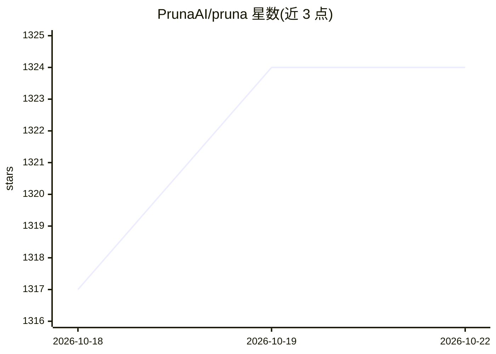

# PrunaAI/pruna

⭐ 1,325 · Python · Apache-2.0 · 推送 2026-10-21 · [GitHub](https://github.com/PrunaAI/pruna) · [官网](https://docs.pruna.ai) · 组织维护

**开发者用的 AI 模型优化框架：压缩模型使其更快更小**

面向开发者的模型优化框架：通过 smash 函数对预训练模型应用缓存、量化、剪枝、蒸馏、编译等 10 类压缩算法，并可组合多种算法，优化后模型按原方式调用。支持 LLM、扩散/流匹配模型、视觉 Transformer、语音识别等多种模型类型。提供评测接口衡量优化后模型性能。pip 安装，需 Python 3.9+，部分算法受操作系统限制，GPU 支持需 CUDA 工具包（可选）。

## 筛选速览

| 维度 | 判定 | 备注 |
|---|---|---|
| AI 角色 | `ai-ecosystem` | LLM/agent 周边工具 |
| 许可风险 | `permissive` | Apache-2.0 |
| 部署形态 | `library` | 以包/库形式分发 |
| 模型依赖 | — | README 未给出锁定关系 |
| 硬件要求 | — | 无带数字的原话,不猜 |
| 安装摩擦 | `low` | 无编译、无系统依赖或容器化 |
| 成熟度 | — | 结构信号不足 |

## 能力要点

- 单一 smash 函数组合多种优化算法，几行代码完成模型压缩
- 10 类算法：batcher/cacher/compiler/distiller/quantizer/pruner 等
- 支持 LLM、扩散模型、视觉 Transformer、语音识别等模型类型
- 内置评测接口衡量优化后模型的性能与质量

## 适用场景

- 压缩扩散模型或 LLM 以降低推理延迟与部署成本
- 在部署前量化/剪枝模型以减少内存占用
- 评测对比优化前后模型的生成质量与速度

## 场景标签

`模型量化` `模型评测` `推理引擎` · 领域:评测与运维

## 证据(README 行号)

> L30: Pruna is a model optimization framework built for developers, enabling you to deliver faster, more efficient models
> L37: The toolkit is designed with simplicity in mind - requiring just a few lines of code to optimize your models. It su

## 星数曲线

2026-10-18 1,317 → 2026-10-22 1,324（+7）

---
*卡片 v1 · prompt 1.4 · 生成 2026-10-21 · 置信度 high · 依据 README sha `3402fd3cf0d7` · [字段定义](../../DATASET.md)*
