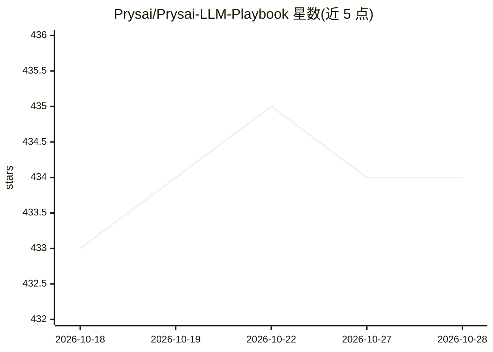

# Prysai/Prysai-LLM-Playbook

⭐ 434 · Python · NOASSERTION · 推送 2026-09-23 · [GitHub](https://github.com/Prysai/Prysai-LLM-Playbook) · [官网](https://docs.prysai.com/llm-playbook/) · 组织维护 · 中文 README

**面向学习者的 LLM 使用课程：五单元基础路线与平台适配层**

独立的书式课程仓库，教授负责任地使用语言模型的可重复循环：定义任务→有界行动→检查结果→留存证据→声明限制。默认路径为五单元 LLM 基础核心（解释、发起、识别、修复、迁移），Codex 旗舰路线与 ChatGPT、Claude Code、Gemini、DeepSeek、Grok 适配器为后续层。提供八语言入口、证据台账（区分已测量/未评分/未知）与多项候选状态练习。项目自声明为 candidate，学习者完成与迁移证据为 not_run。

## 筛选速览

| 维度 | 判定 | 备注 |
|---|---|---|
| AI 角色 | `ai-knowledge` | 知识聚合/清单类 |
| 许可风险 | `none` | NOASSERTION |
| 部署形态 | `None` |  |
| 模型依赖 | — | README 未给出锁定关系 |
| 硬件要求 | — | 无带数字的原话,不猜 |
| 安装摩擦 | `low` | 无编译、无系统依赖或容器化 |
| 成熟度 | `idea` | |

## 能力要点

- 五单元 LLM 基础核心，产出学习者自制的任务卡/结果记录/迁移尝试
- 证据台账区分 measured/unscored/unknown 三类状态
- 八语言入口（含简体中文）
- 五分钟无安装提示词练习与多个候选状态检查工具

## 适用场景

- 初学者系统学习如何检查 LLM 输出而非轻信流畅回答
- 在选定平台前先掌握可迁移的 LLM 使用方法
- 练习识别遗漏、编造、过度自信等模型输出问题

## 场景标签

`教程课程` · 领域:学习与行业

## 证据(README 行号)

> L35: This is an independent, book-shaped curriculum for working with language
> L41: define the task → choose a bounded action → inspect the result → keep evidence → state the limit

## 星数曲线

2026-10-18 433 → 2026-10-28 434（+1）

---
*卡片 v1 · prompt 1.4 · 生成 2026-10-21 · 置信度 high · 依据 README sha `6d02bc3bd7fd` · [字段定义](../../DATASET.md)*
