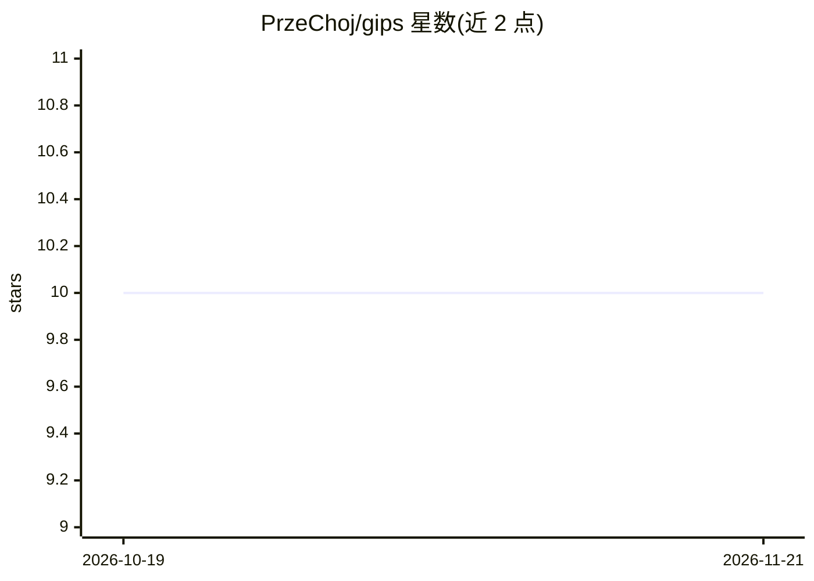

# PrzeChoj/gips

⭐ 10 · R · GPL-3.0 · 推送 2026-11-09 · [GitHub](https://github.com/PrzeChoj/gips) · [官网](https://przechoj.github.io/gips/) · 组织维护

**高斯变量置换对称性发现与协方差估计的 R 包**

面向统计学与数据分析用户的 R 包，在多元高斯样本中搜索变量间的置换对称性，并利用对称约束降低协方差估计的样本量要求。核心机制是基于贝叶斯模型（find_MAP）量化近似对称是否成立，再通过 project_matrix 将协方差矩阵投影到对称约束下，得到可用于 n
 L14: `gips` is an R package that looks for permutation symmetries in the
> L22: 1. Finding hidden symmetries between the variables. `gips` can be used
> L26: 2. Covariance estimation. For an i.i.d. sample from a nondegenerate

## 星数曲线

2026-10-19 10 → 2026-11-21 10（+0）

---
*卡片 v1 · prompt 1.4 · 生成 2026-11-20 · 置信度 high · 依据 README sha `19c2bb8dc105` · [字段定义](../../DATASET.md)*
