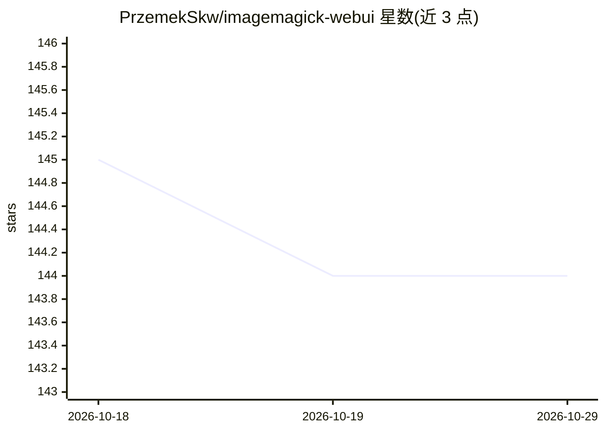

# PrzemekSkw/imagemagick-webui

⭐ 144 · TypeScript · MIT · 推送 2026-10-27 · [GitHub](https://github.com/PrzemekSkw/imagemagick-webui) · 个人维护

**ImageMagick 的 Web 图形界面，含 AI 抠图与批量处理**

基于 Next.js 前端与 FastAPI 后端的 ImageMagick 网页界面：支持调整尺寸/裁剪、7 种格式转换、滤镜与水印、批量处理、实时预览和直接输入 ImageMagick 命令的终端模式。AI 能力包括基于 rembg 的一键背景移除、自动增强与 LANCZOS 算法 2x/4x 放大。通过 docker compose 一条命令部署，含 PostgreSQL/Redis 队列、命令白名单与资源限制等安全配置；非 Docker 本地开发需分别运行 Python 后端与 npm 前端。

## 筛选速览

| 维度 | 判定 | 备注 |
|---|---|---|
| AI 角色 | `ai-enhanced` | 去掉 AI 部分产品仍成立 |
| 许可风险 | `permissive` | MIT |
| 部署形态 | `self-host` | docker 或自建部署 |
| 模型依赖 | — | README 未给出锁定关系 |
| 硬件要求 | — | 无带数字的原话,不猜 |
| 安装摩擦 | `low` | 无编译、无系统依赖或容器化 |
| 成熟度 | — | 结构信号不足 |

## 能力要点

- rembg 一键 AI 背景移除与自动增强、2x/4x 放大
- 批量处理、实时预览与直接执行 ImageMagick 命令的终端模式
- docker compose 单命令部署，含 PostgreSQL 与 Redis 任务队列
- 命令白名单、资源限制（内存 2GB/超时 300s）、非 root 容器

## 适用场景

- 在浏览器里完成图片缩放、转格式、加水印等批量处理
- 一键去除图片背景或放大分辨率
- 用习惯的 ImageMagick 命令通过网页终端模式操作

## 场景标签

`图像视频处理` · 领域:感知与多模态

## 证据(README 行号)

> L11: **A modern, beautiful web interface for ImageMagick with AI-powered features**
> L30: - **Background Removal** - One-click AI background removal using rembg

## 星数曲线

2026-10-18 145 → 2026-10-29 144（-1）

---
*卡片 v1 · prompt 1.4 · 生成 2026-10-22 · 置信度 mid · 依据 README sha `045b6f20847c` · [字段定义](../../DATASET.md)*
