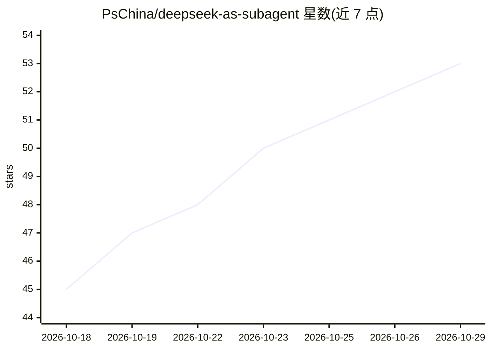

# PsChina/deepseek-as-subagent

⭐ 53 · Python · MIT · 推送 2026-10-28 · [GitHub](https://github.com/PsChina/deepseek-as-subagent) · 个人维护 · 中文 README

**把 DeepSeek 作为子代理运行在 Claude Code/Codex 内的 MCP 服务器**

面向 Claude Code 与 Codex CLI 用户的 MCP 服务器：将 DeepSeek 托管 API 或任意 OpenAI 兼容本地模型封装为拥有独立 agent loop 的子代理，主代理通过 delegate_to_deepseek（编码，含 Bash/文件写入）或 delegate_to_deepseek_readonly（只读分析）委托完整逻辑单元，以节省主模型的端到端 token。提供后台任务（start/send/cancel）、Flash/Pro 双模型档位、工作区路径边界、执行租约与写入变更日志的恢复握手。Bash 运行在受信主机上，非 OS 沙箱；需 Python 3.10–3.12，通过 install.sh 安装并用哈希锁定的依赖。

## 筛选速览

| 维度 | 判定 | 备注 |
|---|---|---|
| AI 角色 | `ai-ecosystem` | LLM/agent 周边工具 |
| 许可风险 | `permissive` | MIT |
| 部署形态 | `None` |  |
| 模型依赖 | locked-api |  |
| 硬件要求 | — | 无带数字的原话,不猜 |
| 安装摩擦 | `low` | 无编译、无系统依赖或容器化 |
| 成熟度 | — | 结构信号不足 |

## 能力要点

- 子代理拥有独立 agent loop（工具分发、文件 I/O、可选命令执行、多轮推理）
- 编码/只读两种能力档位，工具集固定（Read/Write/Edit/Bash/Glob/Grep 等）
- 后台可转向任务与跨进程执行租约（同一工作区仅一个执行）
- Write/Edit/NotebookEdit 变更日志与恢复-验证-确认握手

## 适用场景

- 在 Claude Code/Codex 中把多文件实现、重构、测试生成委托给更便宜的模型
- 把大文件量只读分析（日志扫描、ETL）交给子代理执行以省 token
- 用本地 OpenAI 兼容服务替代 DeepSeek 托管 API 跑子代理

## 场景标签

`编码 Agent` · 领域:编码与开发

## 证据(README 行号)

> L13: > Run DeepSeek — or your own OpenAI-compatible local model — as a **real sub-agent** inside Claude Code / Codex CLI
> L77: - **MCP server** (Python, stdio transport)
> L135: The MCP server itself is client-agnostic. Install `requirements.lock` with

## 星数曲线

2026-10-18 45 → 2026-10-29 53（+8）

---
*卡片 v1 · prompt 1.4 · 生成 2026-10-24 · 置信度 high · 依据 README sha `75e69faac85d` · [字段定义](../../DATASET.md)*
