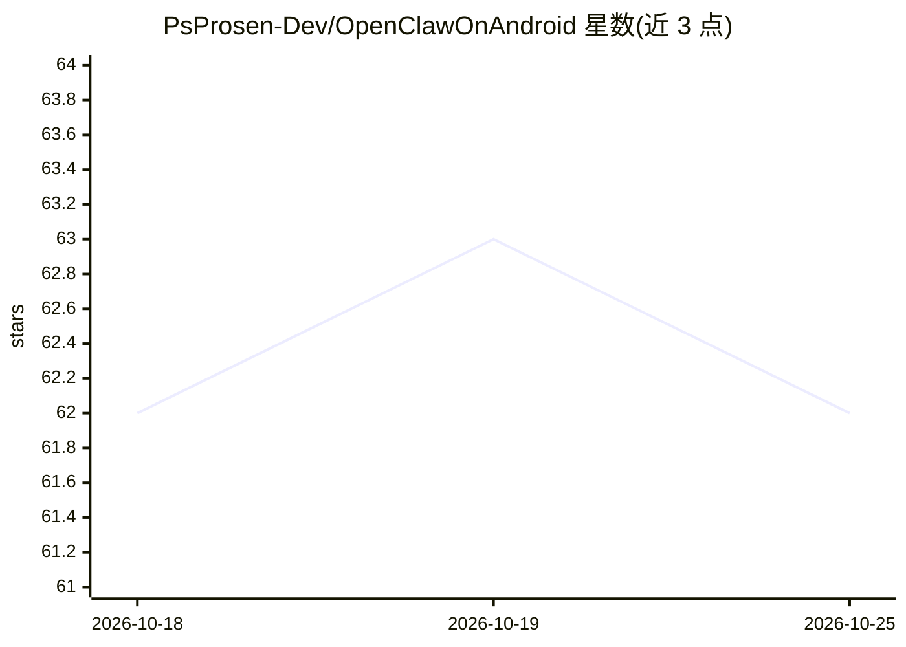

# PsProsen-Dev/OpenClawOnAndroid

⭐ 62 · Java · MIT · 推送 2026-06-03 · [GitHub](https://github.com/PsProsen-Dev/OpenClawOnAndroid) · [官网](https://openclawonandroid.mintlify.app/) · 个人维护

**一条命令把 Android 手机变成运行 OpenClaw 的 AI 服务器**

基于 Termux 的安装与管理层：通过 bootstrap 脚本在 Android 上原生安装 OpenClaw 生态与 glibc 运行时（glibc-runner 注入动态链接器、路径重写、JS 运行时 shim），绕过 Proot/VM，并自动部署 Homebrew、Go 工具链、Node.js v24 及 Qwen Code、Gemini CLI、OpenCode 等 AI CLI 工具。提供 oca 主命令管理更新、状态与卸载，支持 SSH 远程访问与 24/7 无头运行。限制：明确不支持本地 LLM 推理，仅支持云端模型；需 F-Droid 版 Termux 与 ARM64 设备。

## 筛选速览

| 维度 | 判定 | 备注 |
|---|---|---|
| AI 角色 | `ai-ecosystem` | LLM/agent 周边工具 |
| 许可风险 | `permissive` | MIT |
| 部署形态 | `None` |  |
| 模型依赖 | — | README 未给出锁定关系 |
| 硬件要求 | — | 无带数字的原话,不猜 |
| 安装摩擦 | `low` | 无编译、无系统依赖或容器化 |
| 成熟度 | — | 结构信号不足 |

## 能力要点

- bootstrap 脚本一条命令自动安装，宣称 3-10 分钟完成
- glibc-runner 注入 ld-linux-aarch64 绕过 Android 链接器限制，原生执行无需 Proot
- oca 主命令提供更新/状态/清理/卸载等管理功能
- SSH（端口 8022）远程访问与多设备 Dashboard Connect 管理

## 适用场景

- 把闲置 Android 手机改作 24/7 运行的 AI 服务器
- 在手机上通过 Termux 原生运行 OpenClaw 与 AI CLI 工具
- 从 PC 通过 SSH 隧道远程管理手机上的 AI 环境

## 场景标签

`编码 Agent` · 领域:编码与开发

## 证据(README 行号)

> L21: OCA seamlessly installs the **OpenClaw** AI ecosystem directly onto your device via Termux. This completely bypasse
> L119: |Qwen Code, Gemini CLI, OpenCode|

## 星数曲线

2026-10-18 62 → 2026-10-25 62（+0）

---
*卡片 v1 · prompt 1.4 · 生成 2026-10-24 · 置信度 high · 依据 README sha `cf65ab587cbe` · [字段定义](../../DATASET.md)*
