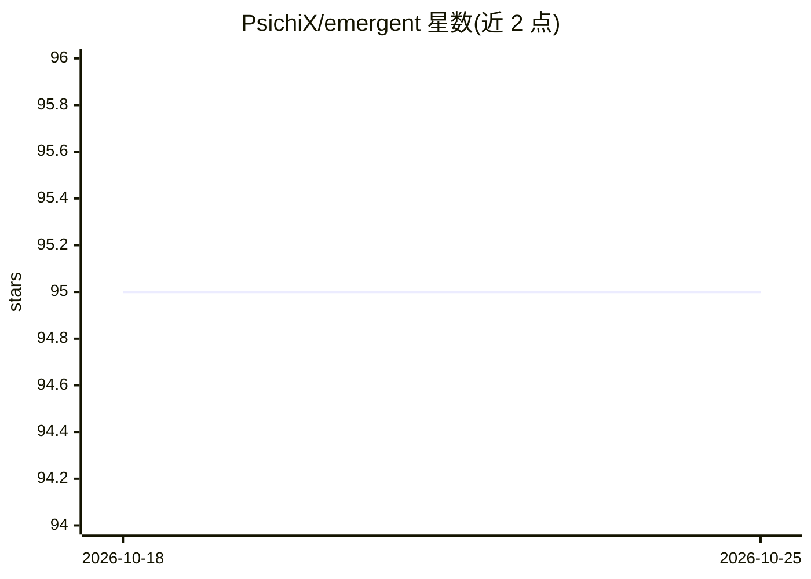

# PsichiX/emergent

⭐ 95 · Rust · NOASSERTION · 推送 2026-06-20 · [GitHub](https://github.com/PsichiX/emergent) · [官网](https://psichix.github.io/emergent/) · 个人维护

**Rust 游戏涌现式玩法 AI 工具库**

面向 Rust 游戏开发的模块化 AI 决策构件库：提供六种决策器——Machinery（有限状态机）、Reasoner（Utility AI 评分选择）、Planner（目标导向行动规划 GOAP）、Sequencer、Selector、Parallelizer，可组合成层级结构驱动智能体与游戏世界行为。以 crates.io 上的 Rust 库形式分发，附 docs.rs 文档与线上书籍，供游戏开发者在自己的项目中集成构建 agent 行为。

## 筛选速览

| 维度 | 判定 | 备注 |
|---|---|---|
| AI 角色 | `ai-ecosystem` | LLM/agent 周边工具 |
| 许可风险 | `none` | NOASSERTION |
| 部署形态 | `library` | 以包/库形式分发 |
| 模型依赖 | — | README 未给出锁定关系 |
| 硬件要求 | — | 无带数字的原话,不猜 |
| 安装摩擦 | `low` | 无编译、无系统依赖或容器化 |
| 成熟度 | — | 结构信号不足 |

## 能力要点

- 六种可组合的决策器（FSM/Utility AI/GOAP/顺序/选择/并行）
- 决策器可嵌套构建层级行为结构
- 提供 docs.rs API 文档与开发指南书籍

## 适用场景

- 为游戏智能体实现状态机或 Utility AI 行为
- 用 GOAP 规划器实现目标导向的行动序列
- 组合多种决策器搭建复杂涌现式游戏行为

## 场景标签

 · 领域:游戏开发/AI 中间件

## 证据(README 行号)

> L7: Emergent AI library is a set of modular building blocks to use for building smart
> L14: - __Machinery__ - Finite State Machine (or simply network of states connected by

## 星数曲线

2026-10-18 95 → 2026-10-25 95（+0）

---
*卡片 v1 · prompt 1.4 · 生成 2026-10-23 · 置信度 high · 依据 README sha `a20dad131e1e` · [字段定义](../../DATASET.md)*
