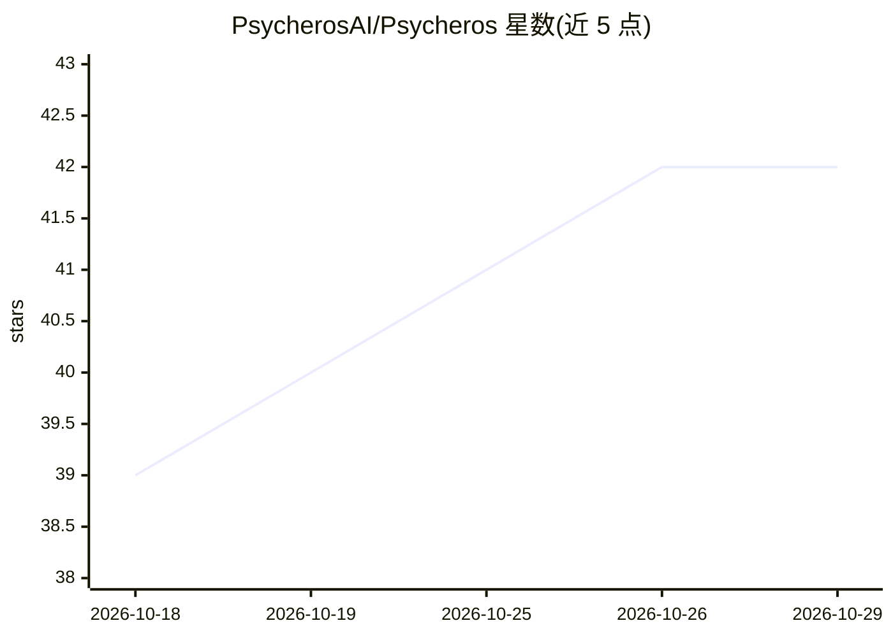

# PsycherosAI/Psycheros

⭐ 42 · TypeScript · NOASSERTION · 推送 2026-10-27 · [GitHub](https://github.com/PsycherosAI/Psycheros) · [官网](https://psycherosai.github.io/Psycheros/) · 个人维护

**开源 agentic AI 伴侣框架：持久身份与多层记忆的实体系统**

基于 Deno 的开源 AI 伴侣运行框架，围绕'实体而非聊天线程'构建：身份与记忆驻留在独立 MCP 服务器 entity-core 中，支持四层记忆体系（日→周→月→年汇总）、知识图谱、RAG 检索与工具访问，使同一实体可在 Web、SillyTavern、OpenWebUI 等多界面间保持一致。提供可插拔 LLM 接入（任意 OpenAI 兼容端点）、Web 搜索、图像生成、Discord 集成、家居自动化与 Pulse 自主定时提示。通过桌面启动器（macOS dmg / Windows msi）安装，面向非技术用户与技术用户分别提供图形安装与源码/Docker 方式。由个人维护者开发，MPL-2.0 许可。

## 筛选速览

| 维度 | 判定 | 备注 |
|---|---|---|
| AI 角色 | `ai-native` | 本体是模型或模型工具 |
| 许可风险 | `none` | NOASSERTION |
| 部署形态 | `desktop` | 安装包/桌面程序 |
| 模型依赖 | — | README 未给出锁定关系 |
| 硬件要求 | — | 无带数字的原话,不猜 |
| 安装摩擦 | `low` | 无编译、无系统依赖或容器化 |
| 成熟度 | — | 结构信号不足 |

## 能力要点

- entity-core 独立 MCP 服务器承载身份与记忆，同一实体跨多界面保持一致
- 四层记忆体系（日/周/月/年汇总）+ 知识图谱 + RAG 检索
- 任意 OpenAI 兼容端点可插拔，支持多命名配置切换
- Pulse 自主提示系统（cron/非活动/webhook/文件系统触发）

## 适用场景

- 搭建有持久身份与长期记忆的 AI 伴侣
- 从 SillyTavern 等平台导入聊天记录并提取记忆
- 让同一 AI 实体在多个客户端界面间保持连续性
- 通过自定义工具文件扩展实体能力

## 场景标签

`Agent 框架` `Agent 记忆` · 领域:Agent 开发

## 证据(README 行号)

> L3: Welcome to Psycheros! This project is an open-source agentic companion harness,
> L56: Psycheros runs an AI entity — not a chat thread. The entity has files describing
> L137: |`packages/psycheros`|The harness — web UI, chat loop, tool execution, RAG|bundled|

## 星数曲线

2026-10-18 39 → 2026-10-29 42（+3）

---
*卡片 v1 · prompt 1.4 · 生成 2026-10-25 · 置信度 high · 依据 README sha `621cd440d5c6` · [字段定义](../../DATASET.md)*
