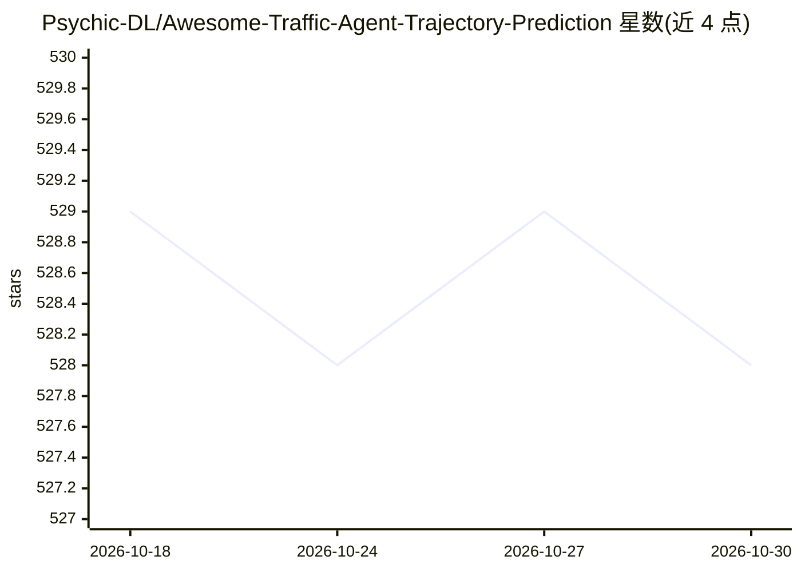

# Psychic-DL/Awesome-Traffic-Agent-Trajectory-Prediction

⭐ 528 · MIT · 推送 2025-12-30 · [GitHub](https://github.com/Psychic-DL/Awesome-Traffic-Agent-Trajectory-Prediction) · 个人维护 · 中文 README

**交通智能体轨迹预测论文与代码的策展清单**

由兰州交通大学个人研究者维护的论文清单仓库，收录交通智能体轨迹预测领域的研究材料（数据集、论文与代码），按传统方法（社会力模型等）、2018 年及以前的会议论文与期刊论文分章节组织，条目附论文链接与部分代码链接，持续更新并接受 PR。维护者在 README 中引用了发表于 IEEE Transactions on Vehicular Technology 的自身论文，并提供微信联系方式以组建轨迹预测社区。

## 筛选速览

| 维度 | 判定 | 备注 |
|---|---|---|
| AI 角色 | `ai-knowledge` | 知识聚合/清单类 |
| 许可风险 | `permissive` | MIT |
| 部署形态 | `None` |  |
| 模型依赖 | — | README 未给出锁定关系 |
| 硬件要求 | — | 无带数字的原话,不猜 |
| 安装摩擦 | `low` | 无编译、无系统依赖或容器化 |
| 成熟度 | — | 结构信号不足 |

## 能力要点

- 覆盖传统方法与深度学习方法的轨迹预测论文条目
- 条目附论文链接与部分代码链接
- 按年份与会议/期刊分类组织
- 持续更新，接受社区 PR 与邮件交流

## 适用场景

- 查找轨迹预测领域的论文与开源代码
- 按时间脉络了解该领域方法演进
- 联系维护者加入轨迹预测研究社区

## 场景标签

`精选清单` · 领域:学习与行业

## 证据(README 行号)

> L13: This is a list of the latest research materials (datasets, papers, and codes) related to traffic agent trajectory p
> L32: # 📚 Traditional Methods

## 星数曲线

2026-10-18 529 → 2026-10-30 528（-1）

---
*卡片 v1 · prompt 1.4 · 生成 2026-10-21 · 置信度 high · 依据 README sha `7f292f561965` · [字段定义](../../DATASET.md)*
