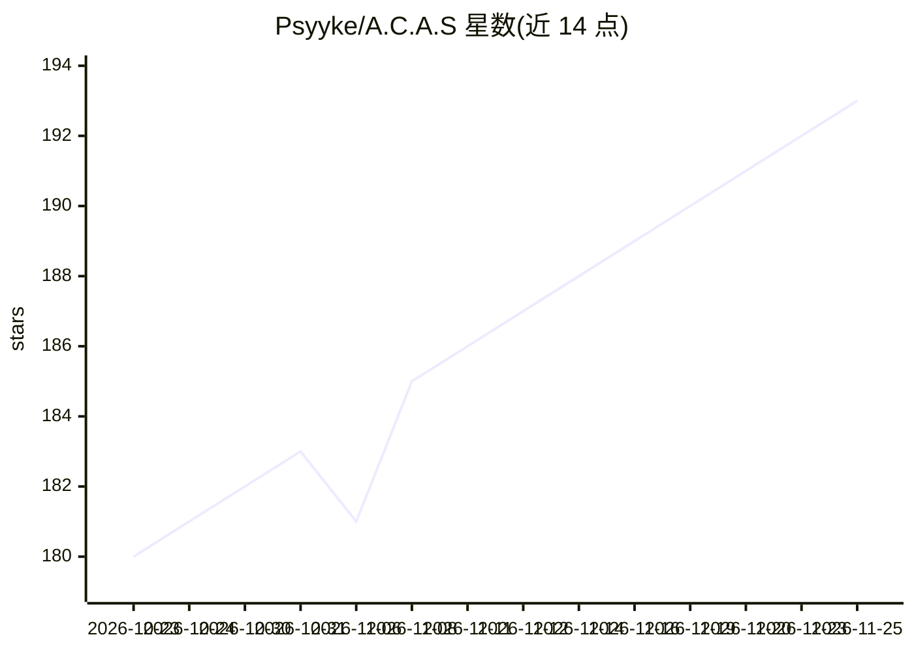

# Psyyke/A.C.A.S

⭐ 193 · JavaScript · GPL-3.0 · 推送 2026-11-11 · [GitHub](https://github.com/Psyyke/A.C.A.S) · [官网](https://psyyke.github.io) · 个人维护

**给棋类玩家提供实时走法建议的浏览器棋类助手**

以用户脚本形式运行的开放源代码国际象棋助手，无需下载安装，支持 chess.com、lichess.org、Pychess.org 等棋类网站。引擎在与棋局页面隔离的独立浏览器标签页中运行，通过跨窗口通信向页面脚本传输走法数据并渲染在棋盘上。内置多个 WebAssembly 引擎，支持修改 UCI 参数、多引擎配置、变体棋类、30+ 种语言界面，并声明可能违反平台规则导致封禁。

## 筛选速览

| 维度 | 判定 | 备注 |
|---|---|---|
| AI 角色 | `ai-native` | 本体是模型或模型工具 |
| 许可风险 | `viral` | GPL-3.0 |
| 部署形态 | `None` |  |
| 模型依赖 | — | README 未给出锁定关系 |
| 硬件要求 | — | 无带数字的原话,不猜 |
| 安装摩擦 | `low` | 无编译、无系统依赖或容器化 |
| 成熟度 | `idea` | |

## 能力要点

- 内置多个 WebAssembly 引擎（Stockfish/Fairy Stockfish/Lozza/ZeroFish）
- 引擎运行在独立标签页，与棋局页面跨窗口通信
- 支持 UCI 选项调整（ELO、depth、multiPV、skill）
- 覆盖变体棋类（chess960、Fairy Stockfish 变体）与 30+ 语言

## 适用场景

- 在支持的在线棋站上获取实时走法建议
- 作为实时学习工具复盘自己的走法
- 在变体棋类（如 chess960）中使用引擎辅助

## 场景标签

 · 领域:游戏/棋类工具

## 证据(README 行号)

> L8: A.C.A.S (Advanced Chess Assistance System) is an open-source chess assistant (**not a chess cheat**), designed to he
> L18: * Many built in WebAssembly engines (faster than JS)
> L82:  The engine runs in a completely separate tab from the chess game, keeping it fully isolated from the game page. Th

## 星数曲线

2026-10-23 180 → 2026-11-25 193（+13）

---
*卡片 v1 · prompt 1.4 · 生成 2026-11-25 · 置信度 high · 依据 README sha `b189b8d850ec` · [字段定义](../../DATASET.md)*
