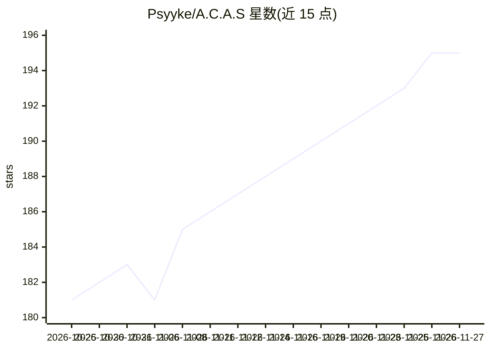

# Psyyke/A.C.A.S

⭐ 195 · JavaScript · GPL-3.0 · 推送 2026-11-26 · [GitHub](https://github.com/Psyyke/A.C.A.S) · [官网](acaschess.com) · 组织维护

**给国际象棋玩家的浏览器引擎辅助脚本：实时给出走子建议**

以 userscript 形式安装的开源国际象棋辅助系统，面向 chess.com、lichess.org、Pychess.org 等棋类网站用户。运行时引擎在与对局页面隔离的独立标签页中执行，通过 CommLink 跨窗口通信传输走子数据，再用 UniversalBoardDrawer 在棋盘上渲染建议箭头。内置多个 WebAssembly 引擎，也可通过本地 localhost 服务器接入外部引擎；支持修改 UCI 选项（ELO、深度、multiPV 等）。README 提示使用该工具可能违反平台规则导致封禁。

## 筛选速览

| 维度 | 判定 | 备注 |
|---|---|---|
| AI 角色 | `ai-native` | 本体是模型或模型工具 |
| 许可风险 | `viral` | GPL-3.0 |
| 部署形态 | `None` |  |
| 模型依赖 | — | README 未给出锁定关系 |
| 硬件要求 | — | 无带数字的原话,不猜 |
| 安装摩擦 | `low` | 无编译、无系统依赖或容器化 |
| 成熟度 | `idea` | |

## 能力要点

- 内置多个 WebAssembly 引擎（Fairy Stockfish、Stockfish、ZeroFish、Maia 等）
- 通过 CommLink 跨窗口通信，引擎运行于独立标签页
- 支持修改引擎 UCI 选项及多引擎各自独立设置
- 支持 chess960 与 Fairy Stockfish 变体，翻译为 30+ 种语言

## 适用场景

- 在对局网站棋盘上实时查看引擎走子建议
- 通过走子反馈和对手预测复盘学习
- 在 chess960 等变体棋局中获得引擎辅助

## 场景标签

 · 领域:游戏/棋类辅助工具

## 证据(README 行号)

> L8: A.C.A.S (Advanced Chess Assistance System) is an open-source chess assistant (**not a chess cheat**), designed to he
> L18: * Many built in WebAssembly engines (faster than JS)
> L82:  The engine runs in a completely separate tab from the chess game, keeping it fully isolated from the game page. Th

## 星数曲线

2026-10-25 181 → 2026-11-27 195（+14）

---
*卡片 v1 · prompt 1.4 · 生成 2026-11-26 · 置信度 high · 依据 README sha `fbd5b2a90f4e` · [字段定义](../../DATASET.md)*
