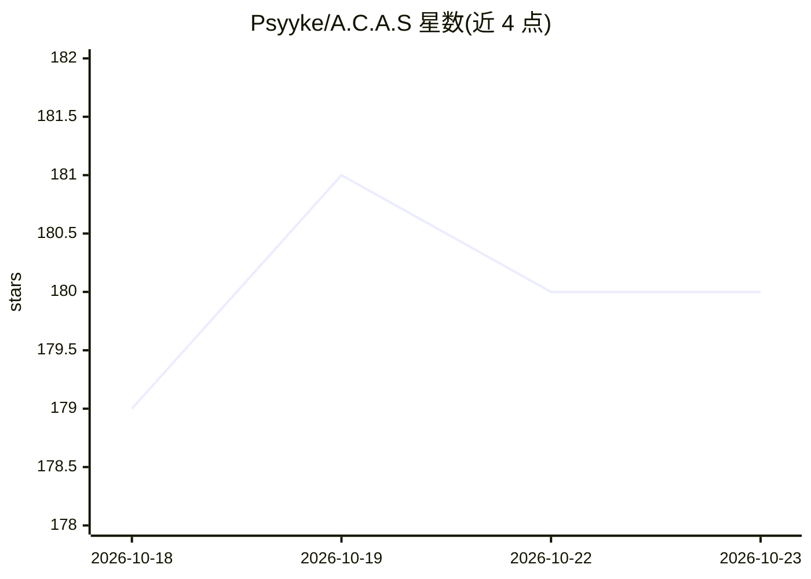

# Psyyke/A.C.A.S

⭐ 180 · JavaScript · GPL-3.0 · 推送 2026-10-18 · [GitHub](https://github.com/Psyyke/A.C.A.S) · [官网](https://psyyke.github.io) · 个人维护

**浏览器国际象棋辅助系统：多引擎实时给出走子建议**

以用户脚本（userscript）形式安装的开源国际象棋辅助工具，支持 Chess.com、Lichess.org、Pychess.org 等站点。内置多个 WebAssembly 引擎（Stockfish、Fairy Stockfish、ZeroFish、Maia 等），也支持经本地服务器接入外部引擎；通过跨窗口通信在独立标签页运行引擎并将走子建议、箭头、对手预测等渲染到对局页面。引擎在独立标签页运行，与对局页面隔离。README 声明仍处于开发阶段、变体模式可能有 bug，并警告使用可能违反平台规则导致封禁。

## 筛选速览

| 维度 | 判定 | 备注 |
|---|---|---|
| AI 角色 | `ai-native` | 本体是模型或模型工具 |
| 许可风险 | `viral` | GPL-3.0 |
| 部署形态 | `None` |  |
| 模型依赖 | — | README 未给出锁定关系 |
| 硬件要求 | — | 无带数字的原话,不猜 |
| 安装摩擦 | `low` | 无编译、无系统依赖或容器化 |
| 成熟度 | `idea` | |

## 能力要点

- 内置多个 WebAssembly 引擎（Stockfish/Fairy Stockfish/ZeroFish/Maia 等）
- 支持外部引擎（经可安装的 localhost 服务器）
- 跨窗口通信隔离运行引擎，避免对局页面干扰
- 支持 Chess.com、Lichess 等主流站点及 Chess960 等变体

## 适用场景

- 在对弈网站获得实时的走子建议与对手预测
- 作为学习工具分析盘面安全区与争夺格
- 调整 UCI 参数（ELO、深度、multiPV）控制建议强度

## 场景标签

 · 领域:游戏辅助/棋类工具

## 证据(README 行号)

> L8: A.C.A.S (Advanced Chess Assistance System) is an open-source chess assistant (**not a chess cheat**), designed to he
> L18: * Many built in WebAssembly engines (faster than JS)

## 星数曲线

2026-10-18 179 → 2026-10-23 180（+1）

---
*卡片 v1 · prompt 1.4 · 生成 2026-10-22 · 置信度 high · 依据 README sha `3acca76f02c9` · [字段定义](../../DATASET.md)*
