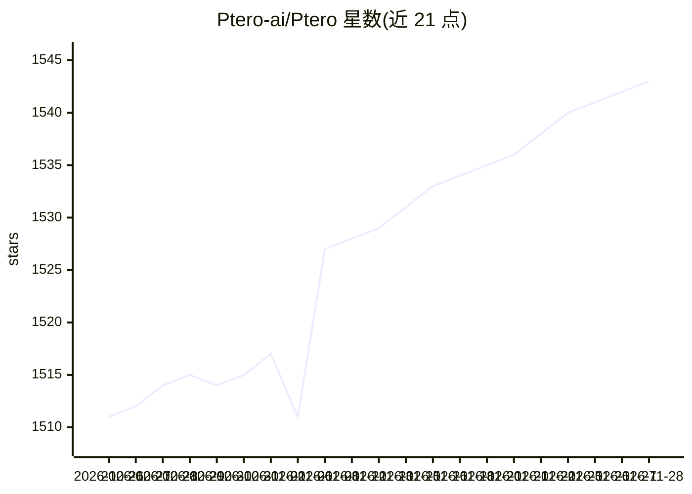

# Ptero-ai/Ptero

⭐ 1,543 · PHP · Apache-2.0 · 推送 2026-11-12 · [GitHub](https://github.com/Ptero-ai/Ptero) · [官网](https://ptero.pro/) · 组织维护

**免费多模型 AI 聊天平台，无需注册即可对话**

开源的 AI 聊天平台，用户通过单一界面访问多个语言模型，支持一键切换模型对比输出、项目化工作区组织会话、聊天内上传管理文件的媒体库。对话默认存储在浏览器本地，项目聊天存储在服务器端。可作为 WordPress 插件安装，通过短代码嵌入聊天界面；前端为 JavaScript/HTML/CSS，后端为 PHP 与 REST API。GPL v2 许可，支持自托管。

## 筛选速览

| 维度 | 判定 | 备注 |
|---|---|---|
| AI 角色 | `ai-native` | 本体是模型或模型工具 |
| 许可风险 | `permissive` | Apache-2.0 |
| 部署形态 | `None` |  |
| 模型依赖 | — | README 未给出锁定关系 |
| 硬件要求 | — | 无带数字的原话,不猜 |
| 安装摩擦 | `low` | 无编译、无系统依赖或容器化 |
| 成熟度 | — | 结构信号不足 |

## 能力要点

- 单界面访问多个语言模型，一键切换对比输出
- 项目化工作区组织会话，聊天内文件上传与管理
- 对话本地存储于浏览器，提供隐私优先设计
- WordPress 插件形式，短代码嵌入聊天界面

## 适用场景

- 不注册账号直接与多个 AI 模型对话
- 为不同任务或客户按项目整理聊天记录
- 在 WordPress 站点页面中嵌入 AI 聊天功能
- 自托管私有聊天平台

## 场景标签

`聊天机器人` · 领域:对话与助手

## 证据(README 行号)

> L10: **Ptero** is a free, open-source AI chat platform that gives you instant access to multiple powerful language model
> L38: - **Access Multiple AI Models**
> L54: Ptero can be easily added to any WordPress site as a plugin.

## 星数曲线

2026-10-26 1,511 → 2026-11-28 1,543（+32）

---
*卡片 v1 · prompt 1.4 · 生成 2026-11-23 · 置信度 high · 依据 README sha `d184b97cfa6e` · [字段定义](../../DATASET.md)*
