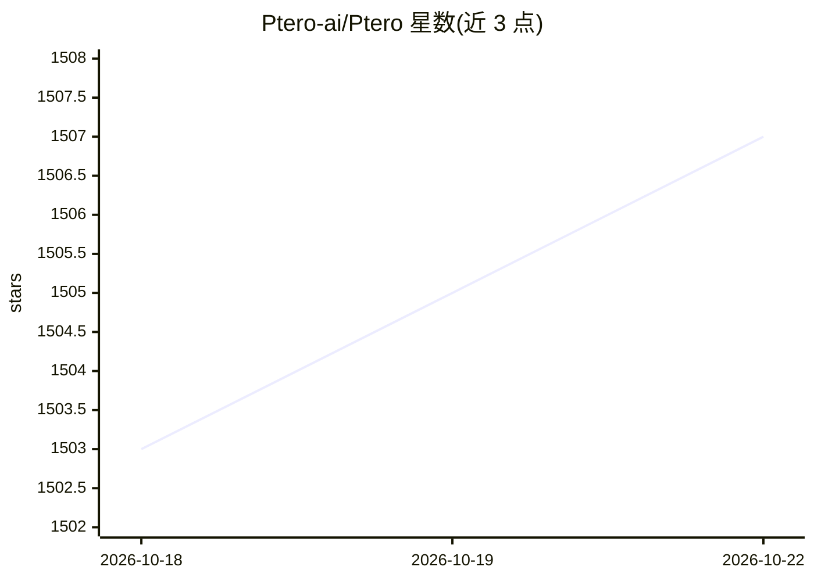

# Ptero-ai/Ptero

⭐ 1,507 · PHP · Apache-2.0 · 推送 2026-10-19 · [GitHub](https://github.com/Ptero-ai/Ptero) · [官网](https://ptero.pro/) · 个人维护

**免注册免费的多模型 AI 聊天平台，可嵌入 WordPress**

面向开发者、学生和创作者的免费开源 AI 聊天平台（GPL v2）：通过单一界面访问 DeepSeek、Llama 3.3、Qwen、MiniMax、Mistral 等多种语言模型，支持一键切换模型、项目式会话管理、媒体库上传。对话记录存储在浏览器本地，服务器不保存聊天历史。模型由 ModelRunner 和 minirouter 提供，非营利项目，无付费计划。使用方式为访问 ptero.pro 在线使用，或作为 WordPress 插件安装后以 [mlp_ai_chat] 短代码嵌入页面。

## 筛选速览

| 维度 | 判定 | 备注 |
|---|---|---|
| AI 角色 | `ai-native` | 本体是模型或模型工具 |
| 许可风险 | `permissive` | Apache-2.0 |
| 部署形态 | `None` |  |
| 模型依赖 | locked-api |  |
| 硬件要求 | — | 无带数字的原话,不猜 |
| 安装摩擦 | `low` | 无编译、无系统依赖或容器化 |
| 成熟度 | — | 结构信号不足 |

## 能力要点

- 单界面访问 DeepSeek/Llama/Qwen/MiniMax/Mistral 等多种模型并可一键切换
- 对话记录仅存于浏览器本地，服务器不保存
- 以 WordPress 插件形式提供，通过 [mlp_ai_chat] 短代码嵌入任意页面
- 免费无付费计划，支持自托管

## 适用场景

- 无需注册即可免费使用多种 AI 模型对话
- 在 WordPress 站点页面嵌入多模型聊天界面
- 按项目组织会话并对比不同模型的输出

## 场景标签

`聊天机器人` · 领域:对话与助手

## 证据(README 行号)

> L10: **Ptero** is a free, open-source AI chat platform that gives you instant access to multiple powerful language model
> L28: - **Access Multiple AI Models**: Choose from a wide range of models, including **DeepSeek V4**, **Llama 3.3**, **Qw

## 星数曲线

2026-10-18 1,503 → 2026-10-22 1,507（+4）

---
*卡片 v1 · prompt 1.4 · 生成 2026-10-21 · 置信度 high · 依据 README sha `e199a8263c81` · [字段定义](../../DATASET.md)*
