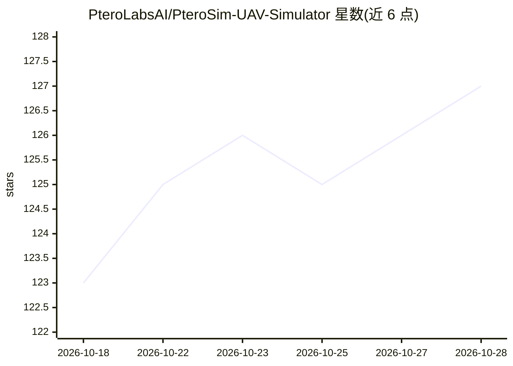

# PteroLabsAI/PteroSim-UAV-Simulator

⭐ 128 · NOASSERTION · 推送 2026-10-25 · [GitHub](https://github.com/PteroLabsAI/PteroSim-UAV-Simulator) · [官网](https://pterolabs.ai/) · 组织维护

**面向开发测试与科研的无人机仿真平台**

由 PteroLabs AI 开发的无人机仿真平台：提供 6 自由度飞行动力学（最高 10 倍实时）、风与湍流建模、IMU/GPS/气压计/空速计/相机等传感器仿真，原生支持 PX4 与 ArduPilot SITL。飞行器以 JSBSim XML 与 glTF 网格形式置于 PteroSimAircrafts/ 目录，可复制修改自定义机型。通过 gRPC API 与 Python SDK（pip install pterosim）进行多机编排。注意：本产品为专有软件，按许可层级授权（含 Free 层）。

## 筛选速览

| 维度 | 判定 | 备注 |
|---|---|---|
| AI 角色 | `ai-ecosystem` | LLM/agent 周边工具 |
| 许可风险 | `none` | NOASSERTION |
| 部署形态 | `library` | 以包/库形式分发 |
| 模型依赖 | — | README 未给出锁定关系 |
| 硬件要求 | — | 无带数字的原话,不猜 |
| 安装摩擦 | `medium` | 含编译或系统依赖之一 |
| 成熟度 | — | 结构信号不足 |

## 能力要点

- 6-DOF 飞行动力学，最高 10 倍实时，含风与湍流建模
- 原生 PX4 与 ArduPilot SITL 支持，覆盖四旋翼/直升机/VTOL/固定翼/尾座机等机型
- 机型由 JSBSim XML 定义，可自由添加自定义飞行器
- gRPC 编程 API 与 Python SDK 支持多机编排

## 适用场景

- PX4/ArduPilot 飞控的 SITL 软件在环仿真开发与测试
- 多机协同算法的编程化仿真验证
- 通过复制 JSBSim XML 机型文件测试自定义飞行器

## 场景标签

`科研工具` · 领域:学习与行业

## 证据(README 行号)

> L32: PteroSim is a UAV simulation platform for drone development, testing, and research. Accurate 6-DOF flight dynamics,
> L41: - Programmatic gRPC API for multi-drone orchestration

## 星数曲线

2026-10-18 123 → 2026-10-28 127（+4）

---
*卡片 v1 · prompt 1.4 · 生成 2026-10-23 · 置信度 mid · 依据 README sha `857fde28aac9` · [字段定义](../../DATASET.md)*
