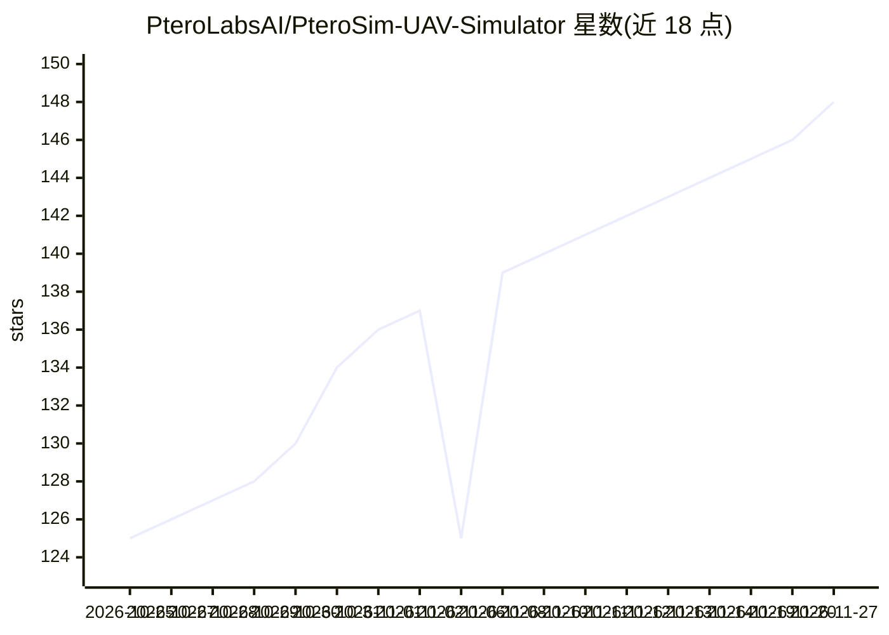

# PteroLabsAI/PteroSim-UAV-Simulator

⭐ 148 · NOASSERTION · 推送 2026-11-24 · [GitHub](https://github.com/PteroLabsAI/PteroSim-UAV-Simulator) · [官网](https://pterolabs.ai/) · 组织维护

**面向无人机开发者的仿真平台，提供6自由度动力学与可编程API**

PteroSim 是一个无人机（UAV）仿真平台，用于无人机开发、测试与研究。提供 6-DOF 飞行动力学（最高 10 倍实时）、风与湍流建模、PX4 与 ArduPilot 的 SITL 支持，传感器仿真覆盖 IMU、GPS、气压计、空速与相机。飞行器以 JSBSim XML 与 glTF 网格的松散文件夹形式发布，可在任意许可层级（含 Free）复制修改为自定义机型；通过 gRPC API 与 Python SDK 支持多机编排。软件为专有许可，发布版内置 JSBSim 与 FFmpeg 库。

## 筛选速览

| 维度 | 判定 | 备注 |
|---|---|---|
| AI 角色 | `ai-enhanced` | 去掉 AI 部分产品仍成立 |
| 许可风险 | `none` | NOASSERTION |
| 部署形态 | `library` | 以包/库形式分发 |
| 模型依赖 | — | README 未给出锁定关系 |
| 硬件要求 | — | 无带数字的原话,不猜 |
| 安装摩擦 | `medium` | 含编译或系统依赖之一 |
| 成熟度 | — | 结构信号不足 |

## 能力要点

- PX4 与 ArduPilot SITL 原生支持
- 飞行器以 JSBSim XML 文件夹形式松散发布，可复制修改自定义机型（Free 层级即可）
- gRPC API 与 Python SDK（pip install pterosim）支持多无人机编排
- 传感器仿真：IMU、GPS、气压计、空速、相机

## 适用场景

- 在仿真环境中开发与测试 PX4/ArduPilot 固件的飞行行为
- 通过 Python/gRPC API 编排多无人机仿真实验
- 复制现有机型文件修改为自定义飞行器模型
- 无人机研究中的传感器与风场扰动建模

## 场景标签

 · 领域:机器人/无人机仿真

## 证据(README 行号)

> L32: PteroSim is a UAV simulation platform for drone development, testing, and research. Accurate 6-DOF flight dynamics,
> L41: - Programmatic gRPC API for multi-drone orchestration
> L100: PteroSim is proprietary software by PteroLabs AI.

## 星数曲线

2026-10-25 125 → 2026-11-27 148（+23）

---
*卡片 v1 · prompt 1.4 · 生成 2026-11-27 · 置信度 mid · 依据 README sha `0f0d7005f6db` · [字段定义](../../DATASET.md)*
