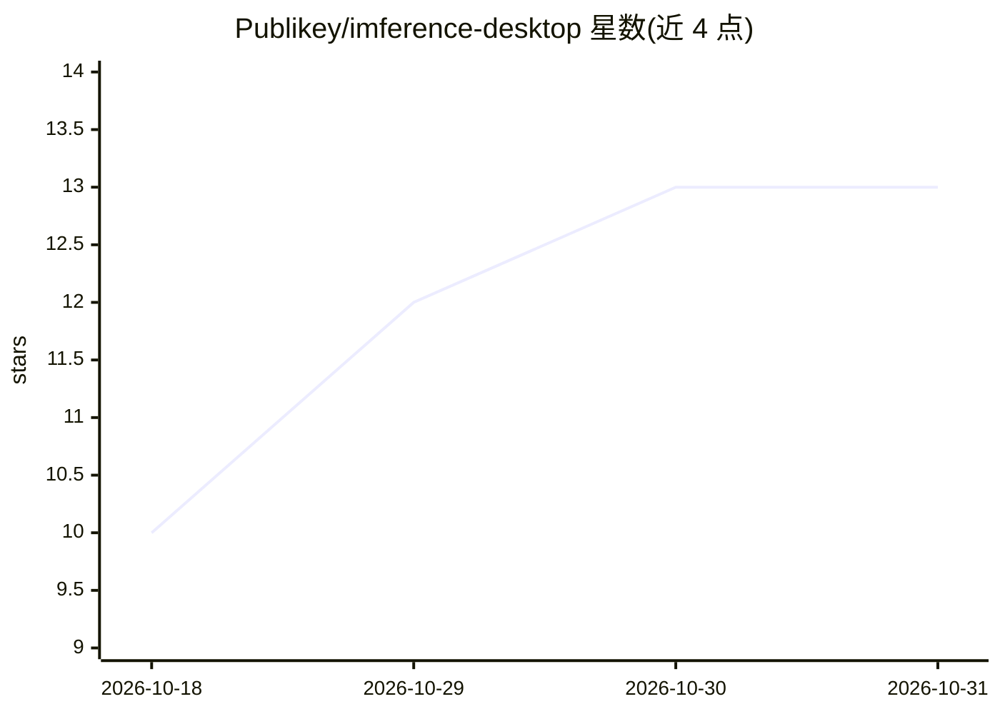

# Publikey/imference-desktop

⭐ 13 · Go · MIT · 推送 2026-10-30 · [GitHub](https://github.com/Publikey/imference-desktop) · [官网](https://imference.com/desktop) · 组织维护 · 中文 README

**本地 GPU 或云端生成 AI 图像/视频的一键桌面应用**

面向终端用户的免费桌面应用（Windows/macOS，Linux 需源码构建）：应用自带隔离推理引擎并检测 GPU，本地可运行 SDXL、SD 1.5、Z-Image、FLUX、Chroma、Qwen-Image、Anima、Krea 2 八个模型家族，权重自动下载且预调参；支持 LoRA 叠加（最多 4 个）、导入本地 .safetensors、图生图与队列。无 GPU 时可切换云端 imference.com（API key 或 x402/USDC 付费）。内置画廊与一组编辑工具（指令编辑、放大、扩图、抠背景等），应用开放时在 127.0.0.1 提供带 token 的本地工具 API 供 agent 调用。另有仅云端的 Web 原型（Go 单代码库 + Docker 部署）。本地模式需 NVIDIA CUDA GPU、AMD RX 7000/9000（ROCm 预览）或 Apple Silicon，每模型约 6–13 GB 磁盘；指令编辑本地需约 12 GB VRAM 与 64 GB RAM。应用未代码签名，首次启动有系统警告。

## 筛选速览

| 维度 | 判定 | 备注 |
|---|---|---|
| AI 角色 | `ai-native` | 本体是模型或模型工具 |
| 许可风险 | `permissive` | MIT |
| 部署形态 | `desktop` | 安装包/桌面程序 |
| 模型依赖 | — | README 未给出锁定关系 |
| 硬件要求 | — | 无带数字的原话,不猜 |
| 安装摩擦 | `low` | 无编译、无系统依赖或容器化 |
| 成熟度 | `idea` | |

## 能力要点

- 本地 GPU 运行 8 个模型家族（SDXL/FLUX/Z-Image/Qwen-Image 等），权重自动下载且预调参
- LoRA 叠加（最多 4 个）与导入本地 .safetensors 检查点
- 图库内置编辑工具：指令编辑、放大、扩图、去背景、修复等，本地或云端执行
- 运行时在 127.0.0.1 提供带 token 保护的本地工具 API，可被 MCP/agent 调用

## 适用场景

- 在自己的 GPU 上免费生成图像与视频，提示词与图片不出本机
- 无 GPU 或显存不足时在同一界面切换云端生成（API key 或 x402 付费）
- 对生成结果做指令编辑、放大、扩图等二次处理
- 通过本地 API 让 AI agent 在本机免费调用图像工具

## 场景标签

`图像生成` `视频生成` `图像视频处理` · 领域:内容生成

## 证据(README 行号)

> L5: **Generate AI images and videos — on your own GPU or in the cloud. One app.**
> L62: - 🖥️ **Local generation, $0 per image** — run **eight model families** on your
> L230: |**Local**|Windows: an NVIDIA GPU (CUDA), or an AMD Radeon RX 7000/9000 (ROCm preview — needs Python 3.12 + a rece

## 星数曲线

2026-10-18 10 → 2026-10-31 13（+3）

---
*卡片 v1 · prompt 1.4 · 生成 2026-10-31 · 置信度 mid · 依据 README sha `31235594b567` · [字段定义](../../DATASET.md)*
