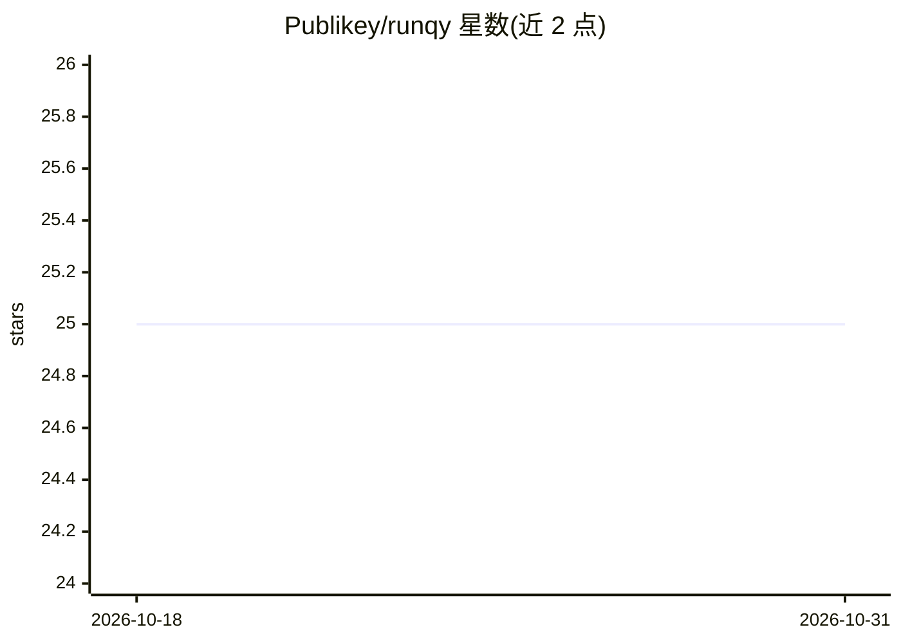

# Publikey/runqy

⭐ 25 · Go · MIT · 推送 2026-10-30 · [GitHub](https://github.com/Publikey/runqy) · [官网](https://runqy.com) · 组织维护

**面向 AI 工作负载的开源分布式任务队列**

Go 服务器 + Python SDK 的分布式任务队列系统：以 YAML 定义队列（含优先级），任务经服务器分发到任意联网机器上的 worker 执行；worker 启动时自动从 Git 拉取代码并安装依赖，实现零接触部署，支持加密环境变量传递密钥。提供 CLI、Web 监控面板（队列状态、worker CPU/内存/心跳）与 Prometheus 指标。运行需 Redis 与 PostgreSQL。面向从笔记本到云端的 GPU 推理、数据管道等场景。

## 筛选速览

| 维度 | 判定 | 备注 |
|---|---|---|
| AI 角色 | `ai-ecosystem` | LLM/agent 周边工具 |
| 许可风险 | `permissive` | MIT |
| 部署形态 | `self-host` | docker 或自建部署 |
| 模型依赖 | — | README 未给出锁定关系 |
| 硬件要求 | — | 无带数字的原话,不猜 |
| 安装摩擦 | `low` | 无编译、无系统依赖或容器化 |
| 成熟度 | — | 结构信号不足 |

## 能力要点

- worker 可运行于笔记本、本地服务器、AWS/Azure/Runpod 等任意联网机器
- 零接触部署：worker 启动时自动从 Git 拉代码并装依赖
- Go 服务器 + Python SDK，YAML 定义队列（优先级路由）
- Web 监控面板 + Prometheus 指标（/metrics）

## 适用场景

- 把 GPU 推理等任务分发到自有或云端 worker 执行
- 用优先级队列处理数据管道、webhook、定时任务
- 远程管理分散部署的 worker 并监控其状态

## 场景标签

`工作流自动化` · 领域:效率与自动化

## 证据(README 行号)

> L5:  Open-source task queue for AI workloads. Deploy workers anywhere, from your laptop to the cloud.
> L22: 🌍 **Workers run anywhere** — Your laptop, on-prem servers, AWS, Azure, Runpod, any machine with an internet connect
> L205:  Built on asynq • Made with ❤️ for AI developers

## 星数曲线

2026-10-18 25 → 2026-10-31 25（+0）

---
*卡片 v1 · prompt 1.4 · 生成 2026-10-27 · 置信度 high · 依据 README sha `e85dd38344bb` · [字段定义](../../DATASET.md)*
