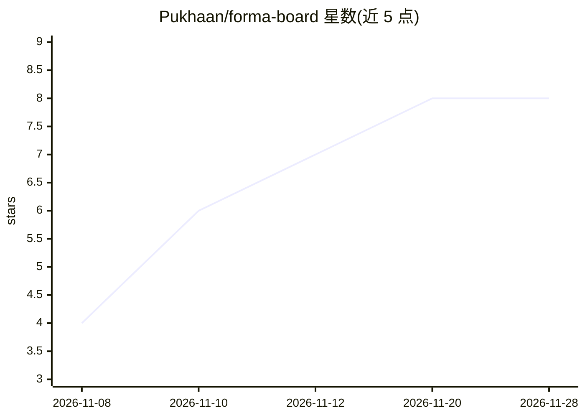

# Pukhaan/forma-board

⭐ 8 · TypeScript · AGPL-3.0 · 推送 2026-11-07 · [GitHub](https://github.com/Pukhaan/forma-board) · [官网](https://formaboard.app) · 个人维护

**给开发者与设计师的本地无限画布，AI 可读写项目资料板**

macOS 上的无限画布应用，把项目的图片、视频、链接、笔记、会议记录与小型代码原型集中到一块白板，用堆叠组织、用连线标注关联原因。每块板是 Mac 上的一个普通文件夹（board.json + media/ + SKILL.md），用户已有 AI（Claude Code、Codex、Cursor 等）可直接读取和编辑该文件夹，应用监听变更并实时显示。通过 npx 安装，也可源码构建（Tauri + Rust + pnpm）。

## 筛选速览

| 维度 | 判定 | 备注 |
|---|---|---|
| AI 角色 | `ai-enhanced` | 去掉 AI 部分产品仍成立 |
| 许可风险 | `viral` | AGPL-3.0 |
| 部署形态 | `library` | 以包/库形式分发 |
| 模型依赖 | — | README 未给出锁定关系 |
| 硬件要求 | — | 无带数字的原话,不猜 |
| 安装摩擦 | `low` | 无编译、无系统依赖或容器化 |
| 成熟度 | `idea` | |

## 能力要点

- 每块板是纯文件夹（board.json/media/components/SKILL.md），无需 Forma 也可读
- AI 通过编辑文件夹给板添加内容，应用监听并实时呈现变更
- SKILL.md 内置 AI 行为规则：可自由添加，改动用户内容前需询问
- 支持堆叠、带说明的连线、⌘K 搜索与版本回退

## 适用场景

- 把项目里散落的灵感截图、笔记和参考资料集中到一块画布
- 让 AI 把下载的截图整理成堆叠并连线到相关内容
- 与团队共享一个解释『为什么相连』的调研板

## 场景标签

`知识库管理` · 领域:知识与检索

## 证据(README 行号)

> L3: **Forma, a visual memory for every project.** One board for you and your AI,
> L25: references. And because the board is a folder, the AI you already use can
> L126: Early, and used daily by its maker for real projects. macOS only for now.

## 星数曲线

2026-11-08 4 → 2026-11-28 8（+4）

---
*卡片 v1 · prompt 1.4 · 生成 2026-11-20 · 置信度 high · 依据 README sha `308737bb5cc7` · [字段定义](../../DATASET.md)*
