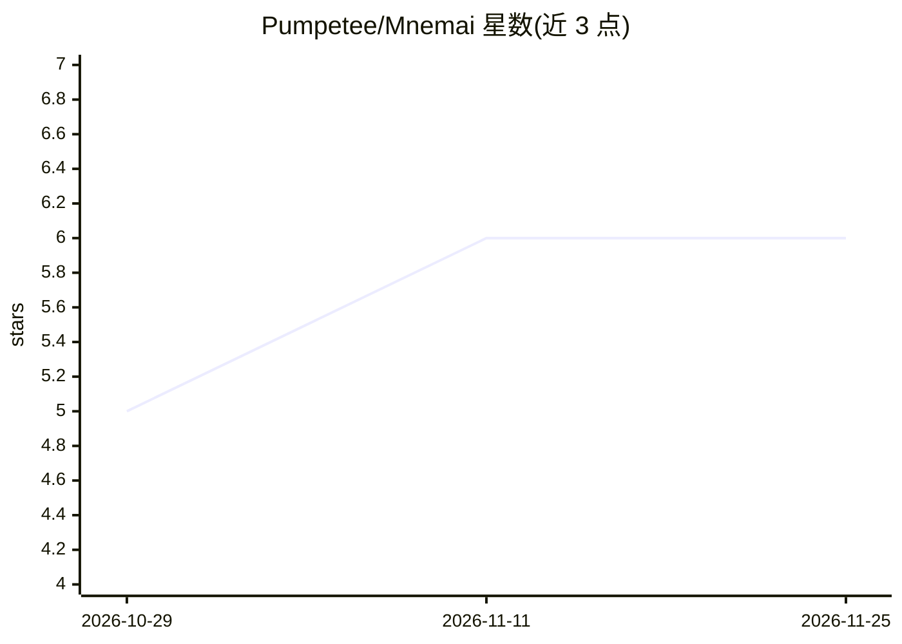

# Pumpetee/Mnemai

⭐ 6 · Python · AGPL-3.0 · 推送 2026-11-23 · [GitHub](https://github.com/Pumpetee/Mnemai) · 个人维护

**本地 Markdown 记忆层桌面应用：为多个 AI 提供共享个人上下文**

以本地文件夹中的纯 Markdown 文件存放用户画像、事实与偏好，接入的每个 AI 聊天时自动读取该上下文；支持 Claude/ChatGPT/Gemini 等云模型与内置本地模型，多模型可按辩论/总结等格式共同产出答案。内置 Whisper 本地转写会议、Telegram 只读学习、AES-256 记忆加密、敏感信息出站标签化，并在长文档上只发送相关片段以减少 token。提供 Windows/macOS/Linux 安装包，也可从源码构建；核心仅依赖 Python 标准库。

## 筛选速览

| 维度 | 判定 | 备注 |
|---|---|---|
| AI 角色 | `ai-native` | 本体是模型或模型工具 |
| 许可风险 | `dual` | AGPL-3.0 |
| 部署形态 | `desktop` | 安装包/桌面程序 |
| 模型依赖 | local-ok | 支持本地模型 |
| 硬件要求 | — | 无带数字的原话,不猜 |
| 安装摩擦 | `low` | 无编译、无系统依赖或容器化 |
| 成熟度 | — | 结构信号不足 |

## 能力要点

- 本地 Markdown 文件形式的记忆层，各 AI 共享同一份上下文
- Consortium 多模型辩论后由一方汇总答案
- 13 个内置本地模型可离线运行，无需 API key
- 记忆 AES-256 加密，敏感信息在出站前标签化

## 适用场景

- 在多个 AI 客户端间避免重复自我介绍与偏好
- 会议录音转写并生成带负责人的任务摘要
- 本地离线运行模型处理隐私敏感对话

## 场景标签

`语音识别` `Agent 记忆` · 领域:Agent 开发

## 证据(README 行号)

> L22: Mnemai remembers who you are, what you are working on, what you decided and how you like answers — and every AI you
> L35:  🗣️ Consortium Claude, ChatGPT and Gemini argue and agree on one answer.
> L39:  💻 Offline 13 free models run on your computer, with no keys.

## 星数曲线

2026-10-29 5 → 2026-11-25 6（+1）

---
*卡片 v1 · prompt 1.4 · 生成 2026-11-20 · 置信度 mid · 依据 README sha `ce4b63e39a74` · [字段定义](../../DATASET.md)*
