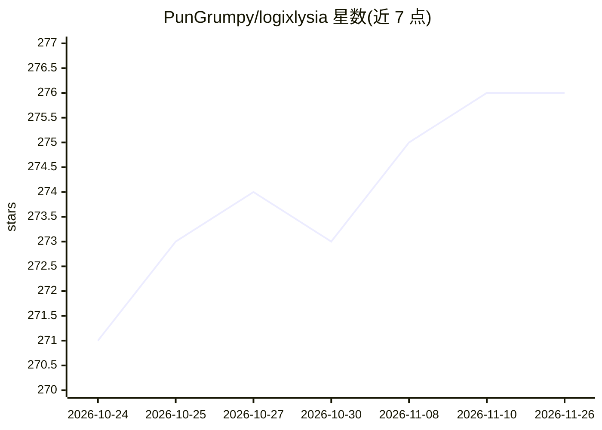

# PunGrumpy/logixlysia

⭐ 276 · TypeScript · MIT · 推送 2026-11-23 · [GitHub](https://github.com/PunGrumpy/logixlysia) · [官网](https://logixlysia.vercel.app) · 个人维护

**ElysiaJS 框架的请求日志中间件插件**

面向 ElysiaJS 应用的日志插件，通过 bun 安装后作为插件挂载。为每个请求输出结构化访问行（时间、方法、路径、状态码、耗时），支持 mergeContext 在请求上下文累积字段；按路径 glob 过滤健康检查与静态资源日志；提供 dev/prod/json 输出预设、按大小/年龄/数量的文件轮转、九个内置日志后端适配器（Axiom、Datadog、Loki、Sentry 等）、采样控制、PII 自动脱敏、请求 ID 与 OpenTelemetry 追踪关联。另提供 testing 模块的内存 transport 供测试断言日志内容。MIT 许可。

## 筛选速览

| 维度 | 判定 | 备注 |
|---|---|---|
| AI 角色 | `ai-enhanced` | 去掉 AI 部分产品仍成立 |
| 许可风险 | `permissive` | MIT |
| 部署形态 | `None` |  |
| 模型依赖 | — | README 未给出锁定关系 |
| 硬件要求 | — | 无带数字的原话,不猜 |
| 安装摩擦 | `low` | 无编译、无系统依赖或容器化 |
| 成熟度 | — | 结构信号不足 |

## 能力要点

- 路径 glob 的 logFilter 包含/排除路由日志
- 九个内置日志后端适配器（Axiom、Datadog、Loki、OTLP、Sentry 等）
- 文件日志按大小/年龄/数量轮转
- logixlysia/testing 内存 transport 支持测试断言

## 适用场景

- 给 ElysiaJS 服务加请求访问日志与结构化错误记录
- 把日志转发到 Datadog、Loki 等现有观测平台
- 测试中断言路由的日志输出并自动脱敏 PII

## 场景标签

 · 领域:Web 开发/可观测性

## 证据(README 行号)

> L2:  Logixlysia is a logging library for ElysiaJS
> L18: import { Elysia } from 'elysia'
> L67: - **Adapters**: nine built-in destinations, Axiom, Better Stack, ClickHouse, Datadog, HyperDX, Loki, OTLP, PostHog,

## 星数曲线

2026-10-24 271 → 2026-11-26 276（+5）

---
*卡片 v1 · prompt 1.4 · 生成 2026-11-25 · 置信度 high · 依据 README sha `4d7897405473` · [字段定义](../../DATASET.md)*
