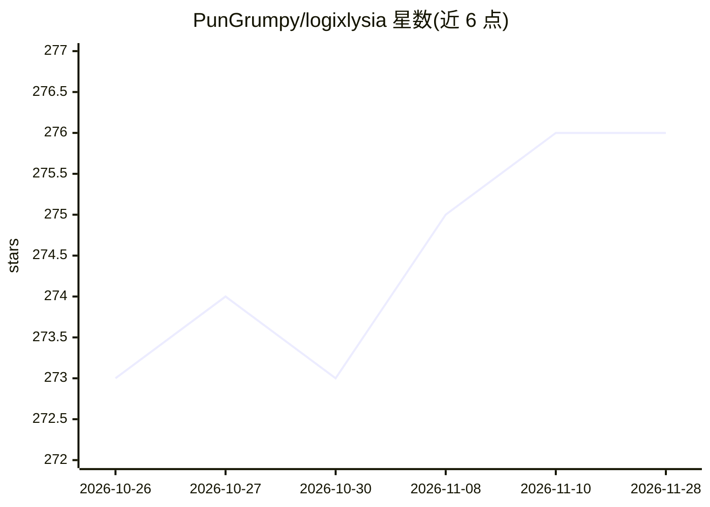

# PunGrumpy/logixlysia

⭐ 276 · TypeScript · MIT · 推送 2026-11-27 · [GitHub](https://github.com/PunGrumpy/logixlysia) · [官网](https://logixlysia.vercel.app) · 个人维护

**ElysiaJS 框架的请求日志插件：记录、过滤与结构化请求日志**

面向 Bun 生态 ElysiaJS 框架的日志中间件插件，通过 bun add 安装后注册为插件即可在 handler 中写日志。提供请求上下文字段累积（mergeContext）、按路径通配符过滤路由日志（logFilter）、dev/prod/json 三种输出预设、按大小/时间/数量轮转的文件日志、头尾采样、PII 自动脱敏、请求 ID、WebSocket 生命周期日志，以及测试用内存 transport。适配器支持 Axiom、Datadog、Loki、OTLP 等 9 个日志后端；OpenTelemetry 追踪关联与 AI usage 指标出现在访问日志中。MIT 许可。

## 筛选速览

| 维度 | 判定 | 备注 |
|---|---|---|
| AI 角色 | `ai-enhanced` | 去掉 AI 部分产品仍成立 |
| 许可风险 | `permissive` | MIT |
| 部署形态 | `None` |  |
| 模型依赖 | — | README 未给出锁定关系 |
| 硬件要求 | — | 无带数字的原话,不猜 |
| 安装摩擦 | `low` | 无编译、无系统依赖或容器化 |
| 成熟度 | — | 结构信号不足 |

## 能力要点

- logFilter 按路径通配符过滤，exclude 优先于 include
- 文件日志支持按大小/时间/数量轮转
- 内置 9 个日志后端适配器（Axiom/Datadog/Loki/OTLP 等）
- logixlysia/testing 提供内存 transport 供测试断言

## 适用场景

- 为 ElysiaJS/Bun 后端 API 记录请求访问日志
- 按路径过滤健康检查与静态资源的日志噪音
- 将请求日志接入 Datadog、Loki 等日志平台
- 在测试中断言路由产生的日志记录

## 场景标签

 · 领域:Web 开发/日志与可观测性

## 证据(README 行号)

> L2:  Logixlysia is a logging library for ElysiaJS
> L17: Add the plugin, then log from a handler with `log`. Fields you add with `log.mergeContext` land on that request's a
> L64: ## `✨` Features

## 星数曲线

2026-10-26 273 → 2026-11-28 276（+3）

---
*卡片 v1 · prompt 1.4 · 生成 2026-11-27 · 置信度 high · 依据 README sha `9aea31affeb6` · [字段定义](../../DATASET.md)*
