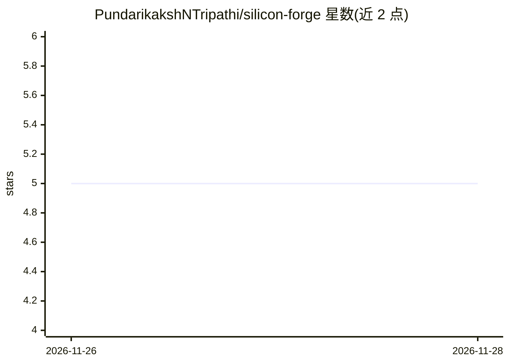

# PundarikakshNTripathi/silicon-forge

⭐ 5 · Python · AGPL-3.0 · 推送 2026-11-27 · [GitHub](https://github.com/PundarikakshNTripathi/silicon-forge) · 个人维护

**面向芯片设计者的 RTL 生成与形式验证开源 EDA 工作台**

基于开源 EDA 的 RTL 工具链：将用户自有 RTL 走 Verilator/Yosys 等价证明/LibreLane-OpenROAD 流程，逐门输出 signoff 报告；同时允许语言模型提出 RTL，但须经形式验证、等价检查与布局通过才被采纳，模型仅提议、工具裁决。附带验证工具包（lockstep 联合仿真、变异测试、覆盖率）、由 isa.yaml 生成的 ISA 工具链、文件夹内 Agent（权限模式、路径限制、撤销）、评测 harness 及 Tiny Tapeout IHP 模式。提供 Windows 桌面安装包与命令行安装，真实流程需安装开源 EDA 工具。

## 筛选速览

| 维度 | 判定 | 备注 |
|---|---|---|
| AI 角色 | `ai-ecosystem` | LLM/agent 周边工具 |
| 许可风险 | `dual` | AGPL-3.0 |
| 部署形态 | `desktop` | 安装包/桌面程序 |
| 模型依赖 | local-ok | 支持本地模型 |
| 硬件要求 | — | 无带数字的原话,不猜 |
| 安装摩擦 | `low` | 无编译、无系统依赖或容器化 |
| 成熟度 | — | 结构信号不足 |

## 能力要点

- 模型提议 RTL，形式证明/等价检查/布局的工具裁决决定通过与否
- 验证工具包：lockstep 联合仿真、变异测试、覆盖率与独立协议解码器
- 单个 isa.yaml 生成解码器、汇编器、golden 模型与文档
- 本地模型运行 .gguf 文件，支持 MCP 服务器接入

## 适用场景

- 不依赖模型，将自有 RTL 走完整开源综合与布局流程
- 让本地模型生成 RTL 并用形式验证筛掉不合格设计
- 从单一 ISA 描述生成完整指令集工具链
- 准备 Tiny Tapeout IHP 流片的 hardening、时序与 DRC

## 场景标签

 · 领域:EDA/芯片设计

## 证据(README 行号)

> L24: 2. **It lets a language model propose RTL, and does not believe it** until formal proof, equivalence checking and l
> L25:  agree. Every edge of the pipeline is decided by a tool verdict. The model only proposes.
> L103: app (`python scripts/build_desktop.py`), the terminal UI (`siliconforge tui`) and an MCP server

## 星数曲线

2026-11-26 5 → 2026-11-28 5（+0）

---
*卡片 v1 · prompt 1.4 · 生成 2026-11-26 · 置信度 high · 依据 README sha `88b9c8680095` · [字段定义](../../DATASET.md)*
