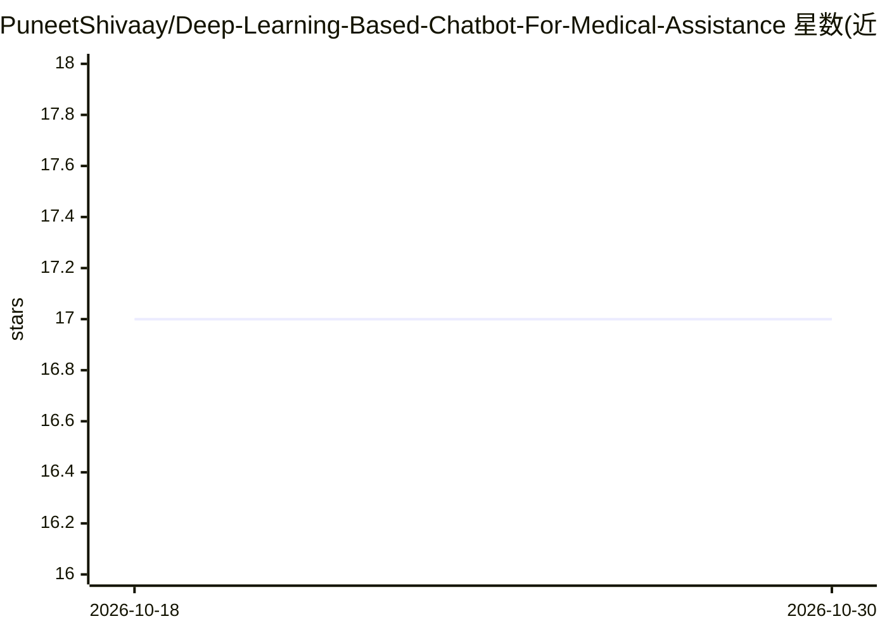

# PuneetShivaay/Deep-Learning-Based-Chatbot-For-Medical-Assistance

⭐ 17 · Python · 推送 2026-09-15 · [GitHub](https://github.com/PuneetShivaay/Deep-Learning-Based-Chatbot-For-Medical-Assistance) · 个人维护

**供学习者的症状输入疾病预测聊天机器人（教育用途）**

基于 Python 与神经网络的医疗辅助聊天机器人：读取 JSON 意图/症状数据训练模型（H5 保存），通过 Tkinter GUI 接收用户症状输入并返回预测的疾病类别；仓库附带预训练模型与序列化文件，可免训练直接运行。README 明确声明仅用于教育实验，未经临床验证，不可替代专业医疗建议。原项目基于 Python 3.7 构建，提供训练与运行两个独立脚本。

## 筛选速览

| 维度 | 判定 | 备注 |
|---|---|---|
| AI 角色 | `ai-native` | 本体是模型或模型工具 |
| 许可风险 | `none` | — |
| 部署形态 | `library` | 以包/库形式分发 |
| 模型依赖 | — | README 未给出锁定关系 |
| 硬件要求 | — | 无带数字的原话,不猜 |
| 安装摩擦 | `low` | 无编译、无系统依赖或容器化 |
| 成熟度 | `idea` | |

## 能力要点

- 神经网络症状→疾病类别预测，附预训练 H5 模型与 pkl 文件
- Tkinter 交互式聊天 GUI
- 训练与运行分离的双脚本结构
- 声明仅限教育/实验用途，未经临床验证

## 适用场景

- 学习神经网络训练与聊天机器人开发的完整流程
- 实验性地演示症状输入到疾病类别的预测
- 作为 GUI 机器学习项目的教学示例

## 场景标签

`聊天机器人` · 领域:对话与助手

## 证据(README 行号)

> L3:  A Python-based deep learning chatbot that analyzes user-provided symptoms and predicts possible diseases using a tr
> L17: **Medical Assistance Chatbot** is a Python-based deep learning project that uses a trained neural network to proces
> L29: * 🩺 Symptom-based disease prediction

## 星数曲线

2026-10-18 17 → 2026-10-30 17（+0）

---
*卡片 v1 · prompt 1.4 · 生成 2026-10-30 · 置信度 mid · 依据 README sha `129863195396` · [字段定义](../../DATASET.md)*
