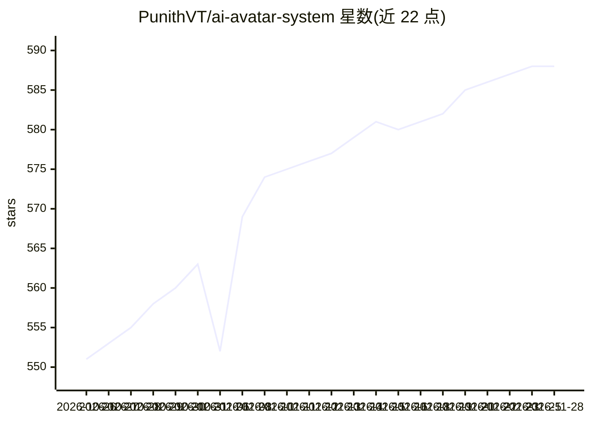

# PunithVT/ai-avatar-system

⭐ 588 · Python · MIT · 推送 2026-11-13 · [GitHub](https://github.com/PunithVT/ai-avatar-system) · [官网](https://github.com/sponsors/PunithVT) · 个人维护

**自托管开源数字人平台：一张照片+一段语音克隆即可实时对话**

基于 Next.js 前端与 FastAPI 后端的开源平台：上传人脸照片、用 10 秒音频做零样本声音克隆（Chatterbox，23 种语言），通过 WebSocket 流式管线将 Whisper STT、可插拔 LLM、TTS 与 MuseTalk 唇形同步视频生成串联，每句回复输出 lip-sync 视频，支持插话打断。提供 JWT 认证、会话历史、Prometheus 监控与 AWS GPU 一键部署脚本；MuseTalk 模型约 9 GB 需单独下载，CPU 模式下唇形同步回退为静态图像。

## 筛选速览

| 维度 | 判定 | 备注 |
|---|---|---|
| AI 角色 | `ai-native` | 本体是模型或模型工具 |
| 许可风险 | `permissive` | MIT |
| 部署形态 | `self-host` | docker 或自建部署 |
| 模型依赖 | local-ok | 支持本地模型 |
| 硬件要求 | — | 无带数字的原话,不猜 |
| 安装摩擦 | `low` | 无编译、无系统依赖或容器化 |
| 成熟度 | — | 结构信号不足 |

## 能力要点

- 流式管线：LLM 逐 token 输出时按句生成 TTS 与唇形视频，首块视频先行播放
- 零样本声音克隆（Chatterbox，10 秒音频，23 种语言）与插话打断（barge-in）
- 多 LLM 后端：Claude（prompt caching）、GPT-4o、以及 Ollama/vLLM/LM Studio 本地模型
- Docker Compose / 手动 / AWS GPU（g5.xlarge）三种部署路径，含 Terraform ECS 方案

## 适用场景

- 给历史人物照片配上克隆声音做实时对话
- 自托管一个多用户数字人网页服务
- 本地模式下用 Ollama 构建数据不出机器的对话头像

## 场景标签

`语音 Agent` `语音合成` `视频生成` `语音识别` · 领域:对话与助手

## 证据(README 行号)

> L28: AvatarAI is an open-source, production-ready platform for building **photorealistic AI avatar conversations**. Uplo
> L35: [mic] → Whisper STT → Claude / GPT / Ollama (streaming) → Chatterbox TTS → MuseTalk lip-sync → [video]
> L45: - 🔌 **Multi-LLM** — Claude (with prompt caching), GPT-4o, or any local model via Ollama / vLLM / LM Studio

## 星数曲线

2026-10-26 551 → 2026-11-28 588（+37）

---
*卡片 v1 · prompt 1.4 · 生成 2026-11-25 · 置信度 mid · 依据 README sha `706e0d9c8a04` · [字段定义](../../DATASET.md)*
